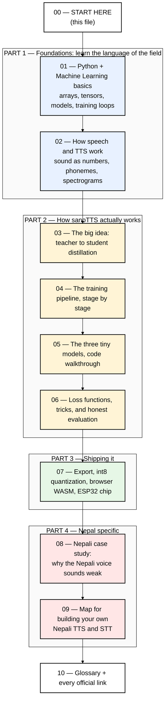
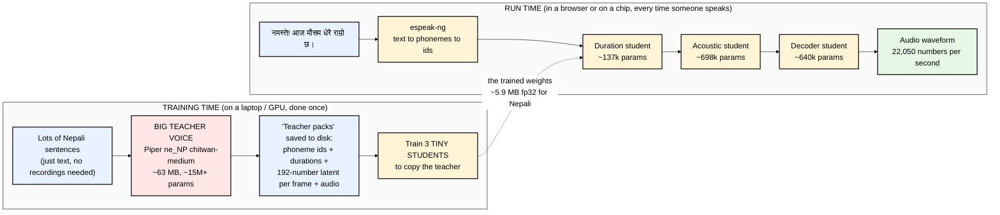
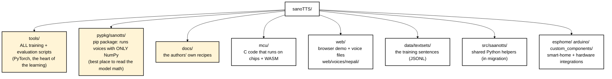

# sanoTTS Study Notes — Start Here

> **Who this is for:** someone building products in Nepal who wants to really understand how a
> text-to-speech (TTS) system is built, starting from zero Python / zero AI-ML knowledge.
>
> **What this is:** a guided reading of the `sanoTTS` codebase. It explains what the code does,
> why it does it, and the ideas underneath. It uses the Nepali voice (नेपाली) as the running example wherever possible.

---

## How to read these notes

The diagrams are written in **Mermaid**, which draws flowcharts from text. To see them as pictures:

- **VS Code:** install the extension *"Markdown Preview Mermaid Support"* (by Matt Bierner), open a file, press `Cmd+Shift+V`.
- **GitHub:** Mermaid renders automatically when you view the `.md` file on github.com.
- **Obsidian / Typora:** Mermaid works out of the box.

Every diagram uses white/light boxes with **black text**, so it stays readable.

---

## The reading order

| # | File | What you'll understand after reading |
|---|------|--------------------------------------|
| 01 | [01-foundations-python-and-ml.md](01-foundations-python-and-ml.md) | What a "model", "parameter", "loss", "training" really mean; enough Python / NumPy / PyTorch to read this repo |
| 02 | [02-how-speech-and-tts-work.md](02-how-speech-and-tts-work.md) | How audio becomes numbers, what phonemes and G2P are, how a modern TTS (VITS / Piper) is shaped |
| 03 | [03-the-big-idea-distillation.md](03-the-big-idea-distillation.md) | The single idea that makes sanoTTS possible: copying a big "teacher" voice into tiny "students" |
| 04 | [04-training-pipeline-step-by-step.md](04-training-pipeline-step-by-step.md) | Every training stage (S1 to S11), what goes in, what comes out, which script does it |
| 05 | [05-the-three-models-code-walkthrough.md](05-the-three-models-code-walkthrough.md) | The exact layers of the duration, acoustic, and decoder models, with tensor shapes for a Nepali sentence |
| 06 | [06-losses-tricks-and-evaluation.md](06-losses-tricks-and-evaluation.md) | How the models are "graded" during training and how the authors measured quality honestly |
| 07 | [07-deployment-quantization-web-and-chip.md](07-deployment-quantization-web-and-chip.md) | How a trained model becomes a 3 MB file in a browser or a 640 KB file on a $3 chip |
| 08 | [08-nepali-case-study.md](08-nepali-case-study.md) | Exactly how the Nepali voice was made, and the concrete reasons it doesn't sound great |
| 09 | [09-roadmap-your-own-nepali-tts-and-stt.md](09-roadmap-your-own-nepali-tts-and-stt.md) | Orientation for later: the realistic paths to a Nepal-first TTS **and** STT |
| 10 | [10-glossary-and-official-links.md](10-glossary-and-official-links.md) | Every term in one place + all the official documentation links |

---

## The whole project in one picture

Read this now and don't worry if it isn't clear yet. By file 06 every box will make sense.

**The one-sentence summary of sanoTTS:**
> Take a good, big, existing open-source voice (the *teacher*). Let it read thousands of sentences.
> Record not just its audio but also its *internal numbers*. Then train three tiny neural networks
> (the *students*, ~1.5 million parameters in total) to reproduce those internal numbers and that audio.
> The students are small enough to run in a web page or on a $3 microcontroller.

---

## Where things live in the repo (the parts that matter for learning)

**The five files that teach you the most:**

1. `docs/distillation-recipe.md` — the authors' own explanation (short, read it after file 03).
2. `docs/roota-language-porting-recipe.md` — how they ported to new languages, **based on the Nepali run**.
3. `tools/train_voice_from_piper.py` — one script that runs the *entire* pipeline; its comments are gold.
4. `pypkg/sanotts/models.py` — the three models written in plain NumPy, about 470 lines.
5. `tools/train_roota_piper_duration_student.py` — the simplest complete PyTorch training script in the repo.

Move on to **[01-foundations-python-and-ml.md](01-foundations-python-and-ml.md)**.
