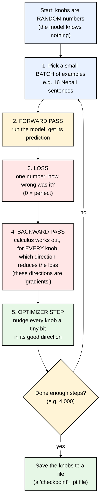

# 01 — Foundations: Python + Machine Learning (just enough to read this repo)

You don't need a degree to follow sanoTTS. You need about **ten ideas**. This file teaches them,
and every example is taken from, or is very close to, real code in this repository.

---

## Part A — The ten ideas of Machine Learning

### Idea 1: A "model" is just a function with adjustable knobs

A normal program has rules a human wrote: `if temperature > 30: say("hot")`.
A **machine-learning model** is a function whose rules are **numbers it learned from examples**.

```
output = model(input, knobs)
```

The knobs are called **parameters** or **weights**. When the README says a voice has
"1.47M parameters", it means the Nepali voice is a function with **1,474,771 adjustable numbers**.
Training is the process of finding good values for those numbers.

### Idea 2: Everything is numbers, arranged in grids (arrays / tensors)

Text, sound, and images all get turned into grids of numbers:

| Thing | As numbers | Shape |
|---|---|---|
| One second of audio at 22,050 Hz | 22,050 decimal numbers between -1 and 1 | `[22050]` |
| A Nepali sentence after phonemization | a list of integers like `[1, 0, 26, 0, 120, ...]` | `[number_of_phonemes]` |
| The teacher's "latent" for a sentence | 192 numbers for every 11.6 ms slice of time | `[192, frames]` |

A grid of numbers is called an **array** (in NumPy) or a **tensor** (in PyTorch). They are the same idea.
Its **shape** tells you how big each dimension is. *Most bugs in ML code are shape bugs,* which is why
the sanoTTS code checks shapes constantly (`if prediction.shape != target.shape: raise RuntimeError(...)`).

### Idea 3: Training = show examples, measure the error, nudge the knobs



One trip around the loop is a **step** (or iteration). The Nepali duration model was trained for
4,000 steps. The size of each nudge is the **learning rate**, `lr` in the code, typically `2e-4` = 0.0002.

### Idea 4: The loss function is how you tell the model what "good" means

The model has no idea what "good speech" is. It only knows how to make the **loss** number smaller.
So **choosing the loss is choosing what the model learns.** Much of sanoTTS's cleverness is in its
losses (file 06). Two simple ones you'll see everywhere:

- **L1 loss** = average of `|prediction − target|` (absolute difference).
- **MSE / L2 loss** = average of `(prediction − target)²` (squared difference).

### Idea 5: Gradient descent (the "nudge") — intuition only

Imagine standing on a foggy hill and wanting to reach the valley (low loss). You can't see far, but you
can feel the slope under your feet. You take a small step downhill, feel again, step again.
The slope is the **gradient**. PyTorch computes it automatically when you call `loss.backward()`,
a feature called **autograd**. You never write the calculus yourself.

The **optimizer** decides exactly how to step. sanoTTS uses **AdamW** everywhere, a smart
variant that adapts the step size for each knob.

### Idea 6: Train set vs. evaluation (held-out) set — don't fool yourself

If you grade a student using the exact questions they practised, you learn nothing about them.
So ML always keeps some examples **hidden during training** and tests on those:

- **train set**: what the model learns from.
- **eval / held-out set**: never seen during training, used only to measure.

sanoTTS keeps the **first 140 sentences** of every corpus out of training: 12 for a "smoke" listening test
and 128 for evaluation (`SMOKE_ROWS = 12`, `EVAL_ROWS = 128` in `tools/train_voice_from_piper.py`).

### Idea 7: Overfitting / memorization

A model that is great on training data but bad on new data has **memorized** rather than **learned**.
This is *the* central problem sanoTTS was designed around. The authors found that a 1M-parameter
model trained to go straight from text to audio just memorizes. Their answer (distillation) is in file 03.

### Idea 8: Layers — models are built from small reusable blocks

A neural network is layers stacked like LEGO. You'll meet these in this repo:

| Layer | What it does, in plain words | PyTorch name |
|---|---|---|
| **Embedding** | a lookup table: phoneme id `26` gives a row of 64 learned numbers that "describe" that sound | `nn.Embedding` |
| **1-D Convolution** | slides a small window along time and mixes neighbours. "Look at this sound and 2 on each side" | `nn.Conv1d` |
| **Transposed convolution** | the reverse: *stretches* a sequence longer (used to go from 86 frames/sec to 22,050 samples/sec) | `nn.ConvTranspose1d` |
| **Activation** | a simple bend like `SiLU` or `LeakyReLU`. Without bends, stacked layers collapse into one straight-line function | `nn.SiLU`, `nn.LeakyReLU` |
| **Residual block** | `output = input + small_change(input)`: each block only learns a *correction*. Makes deep networks train stably | custom class `ResidualConvBlock` |

### Idea 9: Inference = using the trained model

**Training** happens once, is slow, and needs PyTorch. **Inference** means using the trained model to speak.
It happens every time, must be fast, and in sanoTTS needs only NumPy, C, or WebAssembly. The knobs are frozen.

### Idea 10: Precision — how many bytes per number

| Name | Bytes per number | Used in sanoTTS for |
|---|---|---|
| fp32 (float32) | 4 | training; the Nepali web voice (`front_f32.bin`, `dec_f32.bin`) |
| fp16 (float16) | 2 | newer web voices (half the download size) |
| int8 | 1 | the microcontroller voices (needs care: see file 07) |

That's why "1.47M parameters" becomes about 5.9 MB in fp32 but would be about 1.5 MB in int8.

---

## Part B — Just enough Python to read this repo

### B1. Python syntax you'll see constantly

```python
from __future__ import annotations      # lets type hints refer to later classes; ignore it
from pathlib import Path                 # Path("a") / "b" joins file paths safely

def duration_loss(pred_log: torch.Tensor, mask: torch.Tensor, total_weight: float) -> torch.Tensor:
    ...                                  # ": torch.Tensor" and "-> ..." are TYPE HINTS: documentation only,
                                         # Python does not enforce them
```

- **`def`** defines a function. **`class`** defines a blueprint for objects.
- **`self`** inside a class means "this particular object".
- **f-strings**: `f"step {step} loss {loss}"` puts variables into text.
- **`@dataclass`** automatically writes the boring constructor for a class that just holds data.
  See `class Profile` in `tools/train_voice_from_piper.py`.
- **`argparse`**: every script in `tools/` reads command-line flags like `--hidden 64 --steps 4000` with it.
- **`if __name__ == "__main__":`** means "run this only when the file is executed directly, not when it is imported".

### B2. NumPy — arrays on the CPU

```python
import numpy as np

ids = np.array([1, 0, 26, 0, 120, 0, 2])     # shape (7,)
table = np.random.randn(146, 64)             # 146 phonemes x 64 numbers = an embedding table
x = table[ids]                               # "fancy indexing": pick 7 rows -> shape (7, 64)
x = x.T                                      # transpose -> shape (64, 7): channels first, time second
```

`np.repeat(x, durations, axis=1)` is **the most important line in the whole acoustic model**.
If phoneme 1 lasts 3 frames and phoneme 2 lasts 5 frames, it copies column 1 three times and column 2
five times. That is how "a list of sounds" becomes "a timeline". (`pypkg/sanotts/models.py`, `acoustic_forward`.)

### B3. PyTorch — NumPy + automatic gradients + GPU

A PyTorch model is a **class that inherits from `nn.Module`**. It has two parts:

1. `__init__`: **create** the layers (this is where the parameters are born).
2. `forward`: **use** the layers on an input.

Here is the real duration model from `tools/train_roota_piper_duration_student.py`, trimmed and commented:

```python
class ResidualConvBlock(nn.Module):
    def __init__(self, channels, kernel_size):
        super().__init__()
        padding = kernel_size // 2                       # keeps the sequence length the same
        self.net = nn.Sequential(                        # run these layers in order:
            nn.Conv1d(channels, channels, kernel_size, padding=padding),
            nn.SiLU(),                                   # the "bend"
            nn.Conv1d(channels, channels, kernel_size, padding=padding),
        )
        self.scale = nn.Parameter(torch.tensor(0.1))     # a learnable "volume knob", starts small

    def forward(self, x, mask):
        m = mask.unsqueeze(1).to(x.dtype)                # zero out padding positions
        return (x + self.scale * self.net(x * m)) * m    # RESIDUAL: input + small correction


class DurationStudent(nn.Module):
    def __init__(self, *, vocab_size, hidden, depth, kernel_size, max_tokens):
        super().__init__()
        self.embedding  = nn.Embedding(vocab_size, hidden)          # phoneme id -> 64 numbers
        self.input_proj = nn.Conv1d(hidden + 3, hidden, 1)          # +3 = extra hint features
        self.blocks     = nn.ModuleList([ResidualConvBlock(hidden, kernel_size) for _ in range(depth)])
        self.output     = nn.Conv1d(hidden, 1, 1)                   # 64 numbers -> 1 number per phoneme
        self.max_tokens = max_tokens

    def forward(self, ids, mask):
        ...                                               # builds position hints, see file 05
        x = self.embedding(ids).transpose(1, 2)           # [batch, hidden, tokens]
        x = self.input_proj(torch.cat([x, features], dim=1))
        for block in self.blocks:
            x = block(x, mask)
        log_duration = self.output(x).squeeze(1)          # [batch, tokens]
        return log_duration * mask
```

And the real training loop from the same file (trimmed). Compare it with the flowchart in Idea 3:

```python
optimizer = torch.optim.AdamW(model.parameters(), lr=args.lr, weight_decay=args.weight_decay, betas=(0.9, 0.98))

for step in range(1, args.steps + 1):
    batch = [train_samples[rng.randrange(len(train_samples))] for _ in range(args.batch_size)]  # 1. pick
    ids, durations, mask = pad_batch(batch, device)
    pred_log = model(ids, mask)                                                              # 2. forward
    loss, token_loss, total_loss = duration_loss(pred_log, durations, mask, args.total_weight) # 3. loss
    optimizer.zero_grad(set_to_none=True)                                                    #    clear old gradients
    loss.backward()                                                                          # 4. backward
    torch.nn.utils.clip_grad_norm_(model.parameters(), args.grad_clip)                       #    safety: cap huge nudges
    optimizer.step()                                                                         # 5. nudge
```

That's it. **Every training script in `tools/` is this same loop.** They only differ in the model and the loss,
and the big ones have a lot of extra options layered on top.

### B4. "Padding" and "masks" — why they show up everywhere

Sentences have different lengths, but a batch must be a rectangle. So short sentences are
**padded** with zeros at the end, and a **mask** (True/False grid) remembers which positions are real.
Losses are computed only where `mask` is True. That's what `pad_batch` and `pred_log[mask]` do.

### B5. `.pt`, `.onnx`, `.npz`, `.jsonl`, `.bin` — the file types in this project

| Extension | What it is |
|---|---|
| `.pt` | a PyTorch checkpoint: saved weights plus config (training output) |
| `.onnx` | a model saved as a portable **graph** of operations; runs anywhere via ONNX Runtime. **Piper voices are .onnx.** |
| `.onnx.json` | the Piper voice's config: sample rate, espeak voice, the **phoneme → id table** |
| `.npz` | a zip of NumPy arrays; the teacher packs store tensors like this |
| `.jsonl` | "JSON Lines": one JSON object per line, e.g. `{"id": "...", "text": "..."}`. The training sentences use it |
| `.bin` | raw bytes of weights, for the browser/C runtimes |

---

## Check yourself

Try answering these before moving on (answers are in the text above):

1. What is a "parameter", and roughly how many does the Nepali voice have?
2. What are the five steps of the training loop?
3. Why does sanoTTS keep 140 sentences out of training?
4. What does `np.repeat(x, durations, axis=1)` do, and why does TTS need it?
5. Why is the same model about 5.9 MB in fp32 but about 1.5 MB in int8?

Next: **[02-how-speech-and-tts-work.md](02-how-speech-and-tts-work.md)**

### Official links for this chapter
- Python tutorial: https://docs.python.org/3/tutorial/
- NumPy for absolute beginners: https://numpy.org/doc/stable/user/absolute_beginners.html
- PyTorch "Learn the Basics": https://pytorch.org/tutorials/beginner/basics/intro.html
- PyTorch `nn.Conv1d`: https://pytorch.org/docs/stable/generated/torch.nn.Conv1d.html
- PyTorch `nn.Embedding`: https://pytorch.org/docs/stable/generated/torch.nn.Embedding.html
- PyTorch autograd explained: https://pytorch.org/tutorials/beginner/basics/autogradqs_tutorial.html
- AdamW optimizer: https://pytorch.org/docs/stable/generated/torch.optim.AdamW.html
- ONNX introduction: https://onnx.ai/onnx/intro/
- Free course, *Practical Deep Learning* (fast.ai): https://course.fast.ai/
