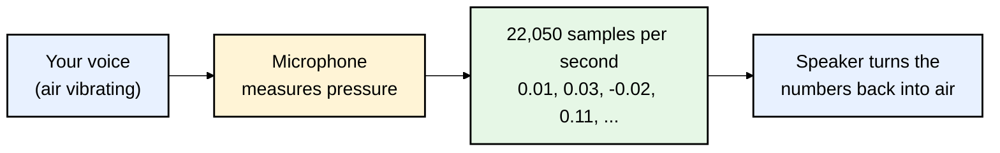
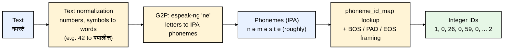
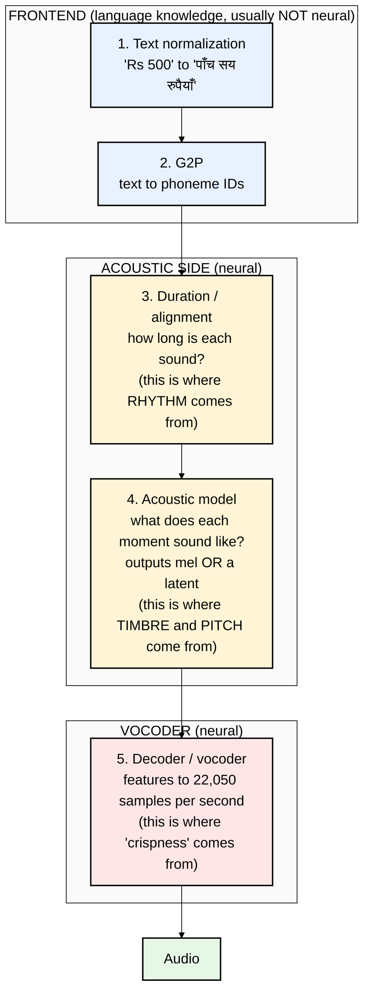
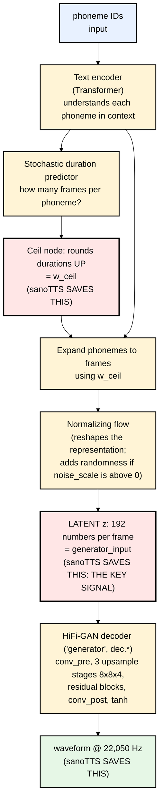

# 02 — How Speech and Text-to-Speech Work

Before reading any TTS code you need a mental picture of (a) what sound is to a computer and
(b) the standard stages every TTS system goes through. This file builds both, using Nepali as the example.

---

## Part A — Sound as numbers

### A1. A waveform is a long list of numbers

A microphone measures air pressure many times per second. Each measurement is a **sample**:
a number between -1 and +1. The measurements per second is the **sample rate**.

- The Nepali sanoTTS voice runs at **22,050 Hz**: 22,050 numbers for every second of speech.
- A 3-second sentence is therefore **66,150 numbers**. Generating those numbers is the TTS system's final job.

### A2. Frames and "hop" — slicing time into chunks

Working sample-by-sample is too fine-grained for most of the model, so time is sliced into **frames**.
The distance between frames is the **hop**.

- sanoTTS hop = **256 samples** → one frame = 256 / 22,050 = **11.6 ms** → about **86 frames per second**.
- The duration model predicts "how many frames" each sound lasts.
- The acoustic model produces one vector of 192 numbers **per frame**.
- The decoder turns every 1 frame into **256 samples**.

This "×256" is baked into the decoder architecture: it stretches by 8, then 8, then 4, and 8×8×4 = 256 (file 05).

### A3. Spectrograms — looking at sound as frequencies

A **spectrogram** shows how much energy each **frequency** (pitch band) has in each frame.
It's computed with the **STFT** (Short-Time Fourier Transform): take a small window of samples,
ask "which frequencies are in here?", slide forward by one hop, repeat.

- A **mel spectrogram** squeezes the frequency axis to match human hearing (we hear low-pitch differences better).
- Most TTS systems predict a mel spectrogram and then use a **vocoder** to turn it into a waveform.
- **sanoTTS's piperlite voices do *not* use mel.** They copy the Piper teacher's own internal 192-number
  representation instead (file 03). The `heart` voices do use a 100-band mel.
- sanoTTS still uses STFTs **inside its loss functions** to compare student audio with teacher audio
  (the "multi-resolution STFT loss", file 06).

### A4. Why some sounds are hard: voiced vs. noisy

- **Vowels** (अ आ इ) are periodic. The vocal cords buzz, so there are clear repeating patterns.
- **Fricatives / sibilants** (स श ष, /s ʃ/) are **noise**: turbulent air, no repeating pattern.
- **Aspiration** (the puff in ख घ थ ध फ भ, very common in Nepali) is also noise-like.

Remember this. A small, *deterministic* model is good at averages, and **the average of noise is silence
or a dull tone**. That is why sanoTTS sibilants came out "whistly", and why the authors invented
"sibilant noise injection" (file 06). **Nepali, with lots of aspirated consonants, is especially exposed to this weakness.**

---

## Part B — Phonemes and G2P (grapheme-to-phoneme)

### B1. Why not feed letters directly?

Spelling ≠ sound. English is the extreme ("though", "through", "tough"). Devanagari is far more regular,
but Nepali still has gaps between writing and speech:

- The **inherent vowel (schwa)**: क is "ka", but at the end of many words the 'a' is *not* spoken.
  `नमस्ते` is not "na-ma-s-te" letter by letter; the conjunct स्ते changes things.
- **Nasalization**: ँ (chandrabindu) and ं (anusvara).
- **Conjuncts**: क्ष, ज्ञ, त्र, and so on.
- **Numbers**, dates, abbreviations, and English words written in Devanagari or Roman script.

So TTS systems first convert text into **phonemes**, the actual sound units, often written in
**IPA** (International Phonetic Alphabet). This step is **G2P: grapheme-to-phoneme.**

### B2. espeak-ng — the G2P used by sanoTTS (and Piper)

**espeak-ng** is an old, open-source, rule-based speech engine. Piper voices use only its G2P part.
It has a Nepali voice (`ne`). In this repo:

- `mcu/ports/wasm/espeak-data-multi/lang/inc/ne` is the Nepali voice definition (`language ne`).
- `mcu/ports/wasm/espeak-data-multi/ne_dict` holds the compiled Nepali pronunciation rules.
- `mcu/ports/wasm/espeak/libespeak-ng/tr_languages.c` (around line 889): **Nepali shares its setup
  with Hindi, Oriya, Punjabi, Gujarati and Marathi.** Same stress lengths, same stress rule
  ("stress on last heaviest syllable"), same Indian number grouping (`BREAK_LAKH_HI`, lakh/crore).

**Important:** espeak-ng Nepali is rule-based and treated as a sibling of Hindi. It makes pronunciation mistakes,
and **the student voice can never pronounce better than the phonemes it's given.** This is one of the
biggest reasons the Nepali voice sounds weak (file 08).

### B3. From phonemes to IDs

Neural networks need integers, not symbols. Each Piper voice ships a **`phoneme_id_map`** in its
`.onnx.json` file, e.g. `"a": [14]`, `"n": [26]`. The Piper framing convention (checked in
`pypkg/sanotts/frontend.py`):

| Symbol | ID | Meaning |
|---|---|---|
| `_` | 0 | PAD, inserted between phonemes |
| `^` | 1 | BOS, beginning of sentence |
| `$` | 2 | EOS, end of sentence |

So a sentence becomes something like `[1, 0, p1, 0, p2, 0, p3, 0, ..., 2]`.
The Nepali student models have a vocabulary of **146** possible IDs (`d_vocab: 146` in `web/voices/nepali/meta.json`).

(The exact phonemes/IDs above are illustrative. The real ones come from espeak and the voice's map.)

---

## Part C — The stages of every neural TTS

Almost every modern TTS, whether Google's, Sarvam's, or Piper, follows this shape:

**sanoTTS maps onto this exactly:** espeak-ng (1+2), duration student (3), acoustic student (4), decoder student (5).

---

## Part D — VITS and Piper: the teacher you need to understand

### D1. What Piper is

**Piper** is a fast, open-source, offline TTS created by Michael Hansen (Rhasspy project, now under the
Open Home Foundation). It publishes hundreds of voices in 35+ languages at
`huggingface.co/rhasspy/piper-voices`, each as an `.onnx` file (~63 MB for "medium") plus an `.onnx.json` config.
Under the hood each Piper voice is a **VITS** model.

**Nepali Piper voices (verified on the official voice list):**

| Voice | Quality | Data | How it was trained |
|---|---|---|---|
| `ne_NP-chitwan-medium` | medium | OHF-Voice voice-datasets (CC0), single speaker | **fine-tuned from the US-English "lessac" voice** |
| `ne_NP-google-medium` / `x_low` | medium / x_low | Google's OpenSLR SLR43 Nepali TTS data (CC-BY-SA-4.0), 18 speakers | fine-tuned from US-English "lessac" |

**sanoTTS's Nepali voice uses `chitwan-medium` as its teacher.**

### D2. What VITS is (the architecture inside every Piper voice)

VITS (2021, Kim et al.) is an "end-to-end" TTS: text in, waveform out, in one network.
Its internal parts matter because **sanoTTS cuts the network open and copies specific internal signals.**

Key facts used by sanoTTS:

- **`scales` input**: every Piper ONNX takes three numbers, `[noise_scale, length_scale, noise_w]`.
  sanoTTS sets them to **`[0, 1, 0]`**, meaning *no randomness*, so the teacher says a sentence
  **exactly the same way every time** (deterministic targets are much easier to copy).
- **`w_ceil`**: the teacher's integer frame count per phoneme. This becomes the **duration student's answer key**.
- **`generator_input`** (the tensor entering `dec.conv_pre`): 192 numbers per frame. This becomes the
  **acoustic student's answer key** and the **decoder student's input**.
- The teacher's decoder has channel widths **256 → 128 → 64 → 32**. The Nepali student decoder keeps
  the same shape but **thinner: 148 → 74 → 37 → 18.** Its starting weights are *cut out of the teacher*.

### D3. "Adversarial" training (GAN) — one more idea you'll need

VITS and HiFi-GAN are trained with a **discriminator**: a second network whose job is to tell real audio
from generated audio. The generator is rewarded for fooling it. This produces sharper, more natural output
than L1/L2 losses alone, which tend to give blurry "average" results. sanoTTS uses discriminators
**only during training** (they are thrown away and never shipped). File 06 explains the three places it uses them.

---

## Check yourself

1. How many audio samples does one sanoTTS frame produce, and how many milliseconds is that?
2. Why are स/श and aspirated consonants hard for a small deterministic model?
3. Which program does G2P for Nepali in sanoTTS, and which languages does it share rules with?
4. What are `w_ceil` and `generator_input`, and which student learns from each?
5. Why does sanoTTS run the teacher with `noise_scale = 0`?

Next: **[03-the-big-idea-distillation.md](03-the-big-idea-distillation.md)**

### Official links for this chapter
- Piper (current, GPL): https://github.com/OHF-Voice/piper1-gpl
- Piper (original, MIT, archived): https://github.com/rhasspy/piper
- Piper voice list: https://github.com/rhasspy/piper/blob/master/VOICES.md
- Piper voices on Hugging Face: https://huggingface.co/rhasspy/piper-voices
- Nepali Piper voices: https://huggingface.co/rhasspy/piper-voices/tree/main/ne/ne_NP
- VITS paper: https://arxiv.org/abs/2106.06103
- HiFi-GAN paper (the decoder inside VITS): https://arxiv.org/abs/2010.05646
- espeak-ng: https://github.com/espeak-ng/espeak-ng
- espeak-ng language/voice docs: https://github.com/espeak-ng/espeak-ng/blob/master/docs/languages.md
- IPA chart (interactive): https://www.ipachart.com/
- OpenSLR SLR43, Google's Nepali TTS data: https://www.openslr.org/43/
- Hugging Face Audio Course (excellent beginner intro to spectrograms and TTS): https://huggingface.co/learn/audio-course
- `torch.stft`: https://pytorch.org/docs/stable/generated/torch.stft.html
