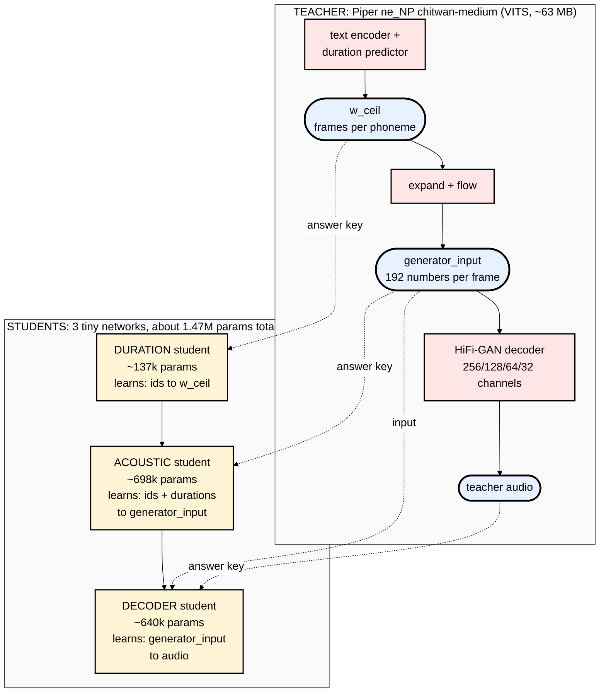
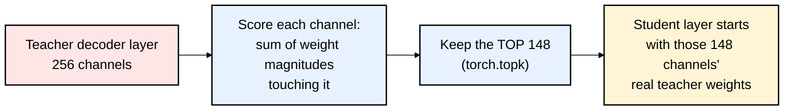
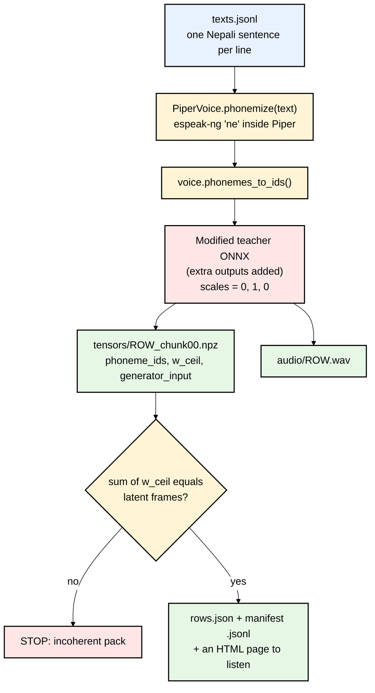
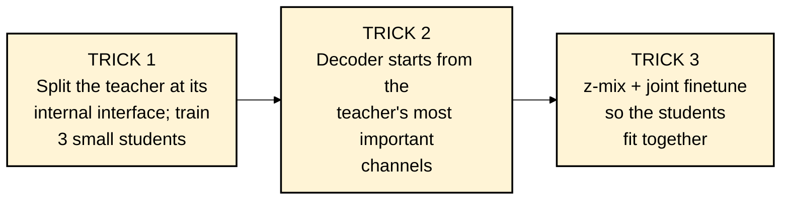

# 03 — The Big Idea: Teacher → Student Distillation

This is the most important file in the series. If you understand this, you understand sanoTTS.

---

## 1. The problem the authors faced

They wanted a TTS **small enough to run on a $3 chip**: about 1–1.5 million parameters.
Good open TTS models are 15M (Piper medium) to 82M (Kokoro) parameters.

The obvious approach is "train a tiny model on recordings, text in, audio out". **It failed.**
From `docs/distillation-recipe.md`:

> Do **not** try to relearn text→acoustics at 1M parameters — it memorizes and cannot speak held-out text.

A tiny model trained from scratch sounds fine on sentences it trained on and falls apart on new ones.

## 2. The solution: knowledge distillation

**Knowledge distillation** (Hinton et al., 2015) means training a small *student* model to imitate
a big *teacher* model, instead of learning from raw data.

Why this works better, in plain words:

| Learning from raw recordings | Learning from a teacher |
|---|---|
| You need real recordings for every sentence | The teacher can **generate unlimited** examples from **text alone** |
| Recordings are messy: breath, noise, a speaker who varies | The teacher is **perfectly consistent** (noise_scale = 0) |
| You only see the final audio | You can see the teacher's **internal signals**, which are easier "answer keys" |
| Model must discover how to align text to audio | The teacher **tells you** the alignment (`w_ceil`) |

The third row is sanoTTS's special trick.

## 3. The special trick: distill against the *interface*, not end-to-end

Instead of one student copying "text → audio", sanoTTS splits the teacher at its internal boundaries
and trains **three students, each copying one piece**:

**Why splitting helps so much:**

1. **Each job is smaller and easier.** Predicting "how many frames for this phoneme" is far easier than
   "what are the 66,000 audio samples for this sentence".
2. **The 192-number latent is a great intermediate target.** The big teacher already did the hard
   thinking (context, intonation, which sounds go where) and compressed it into `generator_input`.
   The student only has to reproduce that compressed summary. The authors call this *"a decodable
   low-dim re-contract of the teacher's latent inherits generalization."* In plain words: copying the
   teacher's summary lets the student inherit the teacher's ability to handle new sentences.
3. **Each piece can be debugged separately.** If the voice sounds bad, you can test
   "teacher latent → student decoder". If that sounds good, the decoder isn't the problem (file 06, "lanes").
4. **The decoder can start from the teacher's own weights** (next section). That's a huge head start.

## 4. The second trick: the decoder is *cut out of the teacher*, never trained from scratch

The teacher's HiFi-GAN decoder has 256 → 128 → 64 → 32 channels. The student decoder has the
**same layer layout but fewer channels** (Nepali: 148 → 74 → 37 → 18).

To initialize it, the code:
1. Rebuilds the teacher decoder in PyTorch and verifies it matches the ONNX version (the "parity" stage).
2. For each layer, **scores every channel by how "important" it is** (the size of its weights).
3. **Keeps the top-scoring channels** and copies their weights into the student.

This is `--teacher-init-method importance`, implemented in `piper_stage_importance_indices()` in
`tools/train_roota_piper_decoder_student.py`. It uses `torch.topk` to pick the channels with the largest weight norms.

From the recipe: *"Teacher-init the decoder. It survives channel-pruning; from-scratch sub-400k decoders are a dead class."*
In plain words: a decoder this small, trained from random numbers, never became good. Starting from the teacher's channels did.

## 5. Rendering the teacher: "packs"

Since the teacher is the data source, step one is to **run the teacher on thousands of sentences and save
everything**. Each saved bundle is called a **pack** (`tools/build_piper_vits_roota_probe_pack.py`).

How it pulls hidden values out of the teacher (a neat ONNX trick):

1. Load the Piper `.onnx` graph with the `onnx` library.
2. **Find the internal tensors by structure.** `w_ceil` is the output of the *only* `Ceil` node.
   `generator_input` is the input to the `Conv` node whose weight is named `dec.conv_pre.weight`.
3. **Add those internal tensors as extra graph outputs** (`make_debug_model`), so ONNX Runtime returns them.
4. Run with `scales = [0, 1, 0]` and save, per sentence chunk, an `.npz` with `phoneme_ids`, `w_ceil`,
   `generator_input` (and, for decoder packs, extra decoder activations), plus a `.wav` of the audio.
5. **Validate**: `sum(w_ceil)` must equal the number of latent frames, or the script stops.

Note what this means for data: **you don't need a single audio recording to make a student.** You need
(1) a teacher voice and (2) text. The teacher's quality becomes the student's **ceiling**.
That matters a lot for Nepali (file 08).

## 6. The third trick: close the gap between the students (z-mix + joint finetune)

There's a subtle trap. The decoder student is first trained on the **teacher's perfect latents**.
At real use, it receives the **acoustic student's imperfect latents**. Small errors can make the decoder produce garbage,
because it has never seen imperfect input. The authors describe the predicted latent landing *"off the decoder's accepted manifold."*

Fixes:
- **z-mix**: while training the decoder, 50% of the time feed it the *acoustic student's* latent
  instead of the teacher's (`--acoustic-latent-mix-prob 0.5`). The decoder learns to be robust.
- **joint finetune**: finally train acoustic + decoder **together** on audio loss, with an "anchor" that keeps
  the latent close to the teacher's (`--z-anchor-weight 0.5`).

From the orchestrator's comments: *"skipping it is the classic failure where every loss looks fine and the voice is brittle."*

## 7. Summary: the three tricks

**What this approach gives up:** the student can only ever be a (slightly worse) copy of **one** teacher voice.
It can't beat its teacher's pronunciation, naturalness, or speaker identity. For Nepali, with a teacher that was itself
fine-tuned from an English voice, that ceiling is low.

Now read the authors' own version: `docs/distillation-recipe.md` (about 150 lines). You'll find you understand it.

Next: **[04-training-pipeline-step-by-step.md](04-training-pipeline-step-by-step.md)**

### Official links for this chapter
- Knowledge distillation paper (Hinton, Vinyals, Dean 2015): https://arxiv.org/abs/1503.02531
- ONNX Python API (loading/editing graphs): https://onnx.ai/onnx/api/index.html
- ONNX `extract_model` utility (used by the decoder cut): https://onnx.ai/onnx/api/utils.html
- ONNX Runtime Python docs: https://onnxruntime.ai/docs/get-started/with-python.html
- Netron, a viewer to *see* a Piper .onnx graph and find `Ceil` / `dec.conv_pre`: https://netron.app/
- `torch.topk`: https://pytorch.org/docs/stable/generated/torch.topk.html
