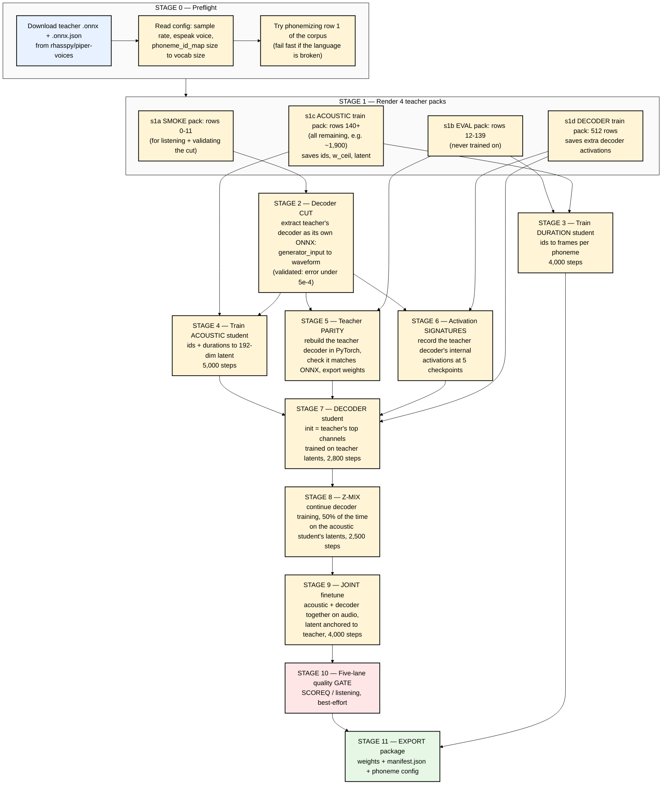

# 04 — The Training Pipeline, Stage by Stage

The whole pipeline is written down as one script: **`tools/train_voice_from_piper.py`**.
It runs about 11 stages in order, skips any stage that already finished (it's *resumable*),
and each stage calls another script in `tools/`.

> **Honesty note:** this orchestrator is the *later, cleaned-up* path used for the Indonesian and
> Vietnamese voices (its docstring says so). The Nepali voice was built earlier, stage by stage, following
> `docs/roota-language-porting-recipe.md`. That recipe is literally *"based on the Root A Nepali, English, Hindi, and Chinese runs"*.
> The stages are the same; some settings differ (file 08).

---

## The master flowchart



---

## Stage-by-stage

### Stage 0 — Preflight (`preflight`, `probe_front_end` in the orchestrator)

**Why:** fail in 10 seconds instead of after 3 hours.
- Downloads the teacher from `huggingface.co/rhasspy/piper-voices` using its `voices.json` index.
- Reads the `.onnx.json`: `phoneme_type` (espeak / pinyin), `espeak.voice` (`ne` for Nepali), `sample_rate`.
- Sets the student **vocabulary size from the teacher's `phoneme_id_map`**, not from the IDs the corpus happens to use.
  Otherwise a sound that's rare in training but appears later would crash or be replaced.
- Phonemizes the first corpus row to prove the front end works for this script.
- Warns if there are fewer than ~1,900 training rows: *"the recipe calls the acoustic data-limited; expect a weaker voice."*

### Stage 1 — Teacher packs (`tools/build_piper_vits_roota_probe_pack.py`)

Explained in file 03, section 5. Four packs from the **same** corpus, split by row position:

| Pack | Rows | Tensor mode | Used by |
|---|---|---|---|
| smoke12 | 0–11 | decoder | the decoder cut's validation; quick listening |
| eval128 | 12–139 | decoder | **every evaluation** (never trained on) |
| train-acoustic | 140 → end | acoustic (ids, w_ceil, latent only, smaller files) | duration + acoustic students |
| train512-decoder | 140–651 | decoder (adds decoder activations) | decoder student |

**Data lesson from the authors:** *"Data provisioning is per-student. The acoustic needs thousands of rows (text variety);
the decoder needs few hundred (latent→audio variety)."*

### Stage 2 — Decoder cut (`tools/extract_piper_vits_decoder_cut.py`)

Uses `onnx.utils.extract_model` to slice the teacher graph from `generator_input` to `output` (waveform).
The result, `*-decoder-from-generator-input.onnx`, is a standalone "latent → audio" oracle.

It's validated by feeding the smoke pack's saved latents and checking the audio matches the saved teacher audio
(mean absolute error ≤ 5e-4). **Why it matters:** later stages call this oracle to create target audio, so it must be exact.

### Stage 3 — Duration student (`tools/train_roota_piper_duration_student.py`)

- **Input:** phoneme IDs. **Target:** the teacher's `w_ceil`.
- Standard shape: `--hidden 64 --depth 3 --kernel-size 5`, 4,000 steps. About 137k parameters for Nepali.
- Predicts `log(duration)`. Working in log space means being off by 1 frame on a 2-frame sound counts as much as
  being off by 5 on a 10-frame sound, which matches how we hear timing.
- Details in files 05 and 06.

### Stage 4 — Acoustic student (`tools/train_roota_piper_latent_student.py`)

- **Input:** phoneme IDs + the **teacher's** durations (during training). **Target:** teacher's `generator_input`.
- Architecture `token_context`, `--hidden 96 --token-depth 3 --depth 4`. About 698k parameters for Nepali.
- Losses: L1 + normalized L1 + "delta" L1 + channel statistics + (newer runs) a **latent discriminator**
  that fights over-smoothing. The orchestrator comments say this is *"worth roughly +1.3 SCOREQ"*.
- Also receives `--decoder <cut.onnx>`, so it can render its predictions to audio for its dashboard.

### Stage 5 — Teacher parity (`verify_piper_decoder_torch_parity.py`, ⚠ not in this repo)

Rebuilds the teacher's HiFi-GAN decoder in PyTorch, loads its weights from the ONNX, and checks that PyTorch and ONNX
give the same audio on 32 rows. Then exports `piper-decoder-teacher.pt`.
The recipe's rule: *"Do not train a compact decoder against a teacher implementation that has not passed parity."*
If you skip this and the student sounds bad, you can't tell if the cause is the compression or a broken teacher copy.

### Stage 6 — Activation signatures (`build_piper_vits_decoder_signature_pack.py`, ⚠ not in this repo)

Runs the decoder-cut on the 512 decoder-train rows and saves **summaries of internal activations** at five points
(`stage0_mix`, `stage1_mix`, `stage2_mix`, `pre_tanh`, `audio`). The student decoder is later nudged to have
*similar internal behaviour*, not just similar output. That's extra guidance for a tiny network.

The orchestrator reads the node names from the graph itself, because the old default names were
*"from a 2026-06 Nepali export"* and don't exist in newer Piper exports.

### Stage 7 — Decoder student (`tools/train_roota_piper_decoder_student.py`)

- `--variant piperlite` with channels `160,80,40,20` (standard) or `148,74,37,18` (Nepali).
- `--teacher-init-method importance`: start from the teacher's most important channels (file 03, section 4).
- **Input:** teacher latent crops (64 frames). **Target:** the decoder-cut's audio for the same latent.
- Losses: waveform L1 + multi-resolution STFT + signature hints + quiet-frame ceiling + adversarial (from step 1,500).
- 2,800 steps at learning rate 2e-4.

### Stage 8 — z-mix (same script, different flags)

- `--init-decoder-checkpoint` = the stage 7 result. `--acoustic-latent-mix-prob 0.5`.
- In each training example, a coin flip decides whether the decoder sees the teacher latent or the acoustic student's prediction.
  Target audio is still the teacher's. Lower learning rate (1e-4), 2,500 steps.

### Stage 9 — Joint finetune (`tools/train_roota_joint_z_finetune.py`)

Trains **acoustic + decoder together**:
`loss = waveform_L1 + spectral + 0.5 × |acoustic_latent − teacher_latent| + adversarial terms`.
The `z_anchor` term stops the pair from "cheating" by drifting to a private latent language the decoder alone understands.
Writes the **two checkpoints that ship**: `joint/latent-student.pt` and `joint/decoder-student.pt`.

### Stage 10 — Gate (`run_roota_feedback_loop.py`, ⚠ not in this repo)

Renders the eval pack through five "lanes" and scores them (file 06). Deliberately non-fatal:
*"a failed gate is a result to read, not a reason to discard the checkpoints."*

### Stage 11 — Export (`export_roota_self_contained_package.py`, ⚠ not in this repo)

Produces a folder with `weights.fp16.bin`, `manifest.json` (parameter counts, byte sizes, tensor table),
`piper-phoneme-config.json`, and a README. **No `.pt`, no `.onnx`, no PyTorch needed to run it.**
The pip package (`pypkg/sanotts/voicepack.py`) reads exactly this format.
The web bundles (`web/voices/<voice>/front_*.bin`, `dec_*.bin`, `meta.json`) are a sibling format for the WASM runtime.

---

## What the shipped settings look like (from the orchestrator)

```python
SIZES = {
    "standard": Size("standard", 64, 96, 4, "160,80,40,20"),   # ~1.56M total (id/vi release)
    "tiny":     Size("tiny",     32, 48, 3, "96,48,24,12"),    # under 500k, for microcontrollers
}
PROFILES = {
    "shipped": Profile("shipped", 4000, 5000, 2800, 2500, 4000),  # duration, acoustic, decoder, zmix, joint steps
    "smoke":   Profile("smoke",    200,  200,  100,  100,  100),  # just to test the plumbing
}
```

**Cost:** "several hours on an M-series box" (Apple Silicon Mac). Most of the time goes into rendering the teacher twice.

**How you'd run it (if all tools were present):**

```bash
python3 tools/train_voice_from_piper.py --voice ne_NP-chitwan-medium --text my_nepali_sentences.jsonl --dry-run
# --dry-run prints every command without running anything: read it first!
```

---

## ⚠ Reproducibility gaps in this repo (important before you try to train)

I checked: the orchestrator and the porting recipe call these scripts, and **they are not committed in this repository**:

| Missing script | Used in stage |
|---|---|
| `tools/verify_piper_decoder_torch_parity.py` | 5 (teacher parity, which also produces the decoder's initial weights) |
| `tools/build_piper_vits_decoder_signature_pack.py` | 6 (signatures) |
| `tools/run_roota_feedback_loop.py`, `tools/summarize_roota_feedback_loop.py` | 10 (gate) |
| `tools/export_roota_self_contained_package.py` | 11 (export) |
| `tools/probe_piper_vits_onnx.py` | teacher probing in the porting recipe |
| `tools/make_multilang_text_distill_corpus.py` | `--auto-text` corpus generation |

Also, several scripts have **hard-coded default paths** to the authors' machines (e.g. `ROOT.parent / "g2p" / "data" / ... / "ne_NP" / "chitwan-medium.onnx"`),
and the preserved checkpoints (`artifacts/...`) are not in git.

**What this means:** stages 1–4 and 7–9 have their code here. To run everything end-to-end you'd need to write
the missing pieces (stage 5 is the most important), or ask the authors. That's a good future exercise, and we can do it together.

Next: **[05-the-three-models-code-walkthrough.md](05-the-three-models-code-walkthrough.md)**

### Official links for this chapter
- Piper voices index (`voices.json`): https://huggingface.co/rhasspy/piper-voices/blob/main/voices.json
- Piper training guide (how the teachers themselves are trained): https://github.com/OHF-Voice/piper1-gpl/blob/main/docs/TRAINING.md
- Python `argparse` tutorial: https://docs.python.org/3/howto/argparse.html
- `subprocess` (how the orchestrator runs each stage): https://docs.python.org/3/library/subprocess.html
- JSON Lines format: https://jsonlines.org/
