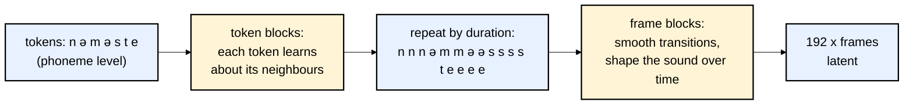
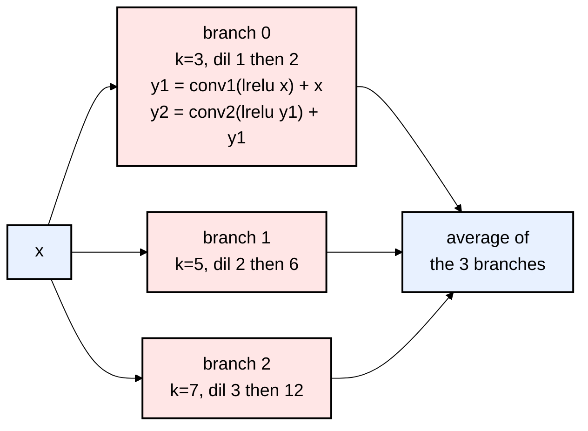

# 05 — The Three Tiny Models: A Code Walkthrough

The easiest place to read the models is **`pypkg/sanotts/models.py`**. It's the same math as the PyTorch
training code, rewritten in plain NumPy for the pip package. There's no training machinery in it, just the forward pass.
This file follows one Nepali sentence through all three models and tracks the **shape** of the data at every step.

**Our example:** `नमस्ते! आज मौसम धेरै राम्रो छ।` (the demo sentence in `web/index.html`).
Let's pretend espeak + Piper framing turns it into **N = 60 phoneme IDs**. The real number depends on espeak.

Nepali model sizes come from `web/voices/nepali/meta.json`:

| Model | Setting | Value |
|---|---|---|
| Duration | vocab / hidden / depth / kernel | 146 / 64 / 3 / 5 |
| Duration | max tokens / max duration | 533 / 80 frames |
| Acoustic | vocab / hidden / token_depth / depth / kernel | 146 / 96 / 3 / 4 / 5 |
| Acoustic | output channels | 192 |
| Decoder | channels c0/c1/c2/c3 | 148 / 74 / 37 / 18 |
| Decoder | hop | 256 |

---

## The full data flow with shapes

```mermaid
%%{init: {"theme": "base", "themeVariables": {"fontSize": "18px", "primaryColor": "#ffffff", "primaryTextColor": "#000000", "primaryBorderColor": "#000000", "lineColor": "#000000", "clusterBkg": "#fafafa", "clusterBorder": "#000000", "edgeLabelBackground": "#ffffff"}}}%%
flowchart TD
    classDef d fill:#e8f1ff,stroke:#000,stroke-width:2px,color:#000;
    classDef m1 fill:#fff4d6,stroke:#000,stroke-width:2px,color:#000;
    classDef m2 fill:#ffe9cc,stroke:#000,stroke-width:2px,color:#000;
    classDef m3 fill:#ffe6e6,stroke:#000,stroke-width:2px,color:#000;
    classDef o fill:#e6f7e6,stroke:#000,stroke-width:2px,color:#000;

    IDS["phoneme ids<br/>shape: 60"]:::d

    subgraph DUR["DURATION STUDENT (~137k params)"]
        D1["Embedding lookup<br/>60 ids to 64 numbers each<br/>shape: 64 x 60"]:::m1
        D2["+ 3 hint rows: position 0 to 1,<br/>sentence-length hint, valid flag<br/>shape: 67 x 60"]:::m1
        D3["1x1 conv 'input_proj'<br/>shape: 64 x 60"]:::m1
        D4["3 x ResidualConvBlock (kernel 5)<br/>shape: 64 x 60"]:::m1
        D5["1x1 conv 'output' to log-duration<br/>shape: 60"]:::m1
        D6["exp, clip at least 1, times length_scale,<br/>round, clip at most 80<br/>durations e.g. 3, 1, 5, 2, ...<br/>sum = 172 frames"]:::m1
        D1 --> D2 --> D3 --> D4 --> D5 --> D6
    end

    subgraph AC["ACOUSTIC STUDENT (~698k params)"]
        A1["TOKEN stage: Embedding<br/>shape: 96 x 60"]:::m2
        A2["+ 2 hints: token position,<br/>log-duration hint<br/>1x1 conv, then 3 residual blocks<br/>shape: 96 x 60"]:::m2
        A3["EXPAND: np.repeat by durations<br/>each token column copied d times<br/>shape: 96 x 172"]:::m2
        A4["+ 3 frame hints: frame position,<br/>token position, position INSIDE the phoneme<br/>1x1 conv, then 4 residual blocks<br/>shape: 96 x 172"]:::m2
        A5["1x1 conv 'output'<br/>LATENT shape: 192 x 172"]:::m2
        A1 --> A2 --> A3 --> A4 --> A5
    end

    subgraph DEC["DECODER STUDENT 'piperlite' (~640k params)"]
        C1["conv 'pre' 192 to 148<br/>shape: 148 x 172"]:::m3
        C2["LeakyReLU, ConvTranspose x8<br/>then residual bank (kernels 3, 5, 7)<br/>shape: 74 x 1,376"]:::m3
        C3["LeakyReLU, ConvTranspose x8<br/>then residual bank<br/>shape: 37 x 11,008"]:::m3
        C4["LeakyReLU, ConvTranspose x4<br/>then residual bank<br/>shape: 18 x 44,032"]:::m3
        C5["conv 'post' 18 to 1, then tanh<br/>shape: 44,032"]:::m3
        C1 --> C2 --> C3 --> C4 --> C5
    end

    WAV["AUDIO: 44,032 samples<br/>= 2.0 seconds @ 22,050 Hz"]:::o

    IDS --> D1
    IDS --> A1
    D6 --> A2
    D6 --> A3
    A5 --> C1
    C5 --> WAV
```



Check the arithmetic: 172 frames × 8 × 8 × 4 = 172 × 256 = **44,032 samples** = 2.0 s.

---

## Model 1 — Duration student

**Job:** for each phoneme, predict how many 11.6 ms frames it lasts.

Real code (`pypkg/sanotts/models.py`, `duration_forward`), with comments added:

```python
embed = tensors["embedding.weight"]            # [146, 64]: one learned row per phoneme id
token_x = embed[ids].T                         # [64, N]

positions   = linspace01(n)                    # 0.0 ... 1.0 : "where in the sentence am I?"
length_hint = log1p(n) / log1p(max_tokens)     # "how long is this sentence?" (same value for every token)
valid_hint  = ones(n)                          # 1 = real token (in training, 0 = padding)
features = np.stack([positions, full(n, length_hint), valid_hint])   # [3, N]

x = conv1d_1x1(concat([token_x, features]), input_proj)              # [64, N]
for i in range(depth):                                               # depth = 3
    x = residual_conv_block(x, tensors, f"blocks.{i}")               # x + scale * conv(silu(conv(x)))

log_duration = conv1d_1x1(x, output)[0]        # [N]
duration = exp(log_duration)                   # back from log space
duration = clip(duration, 1, None)             # every phoneme gets at least 1 frame
duration = round(duration * length_scale)      # length_scale > 1 = slower speech (tunable, no retraining)
duration = clip(duration, 1, max_duration)     # at most 80 frames (~0.93 s)
```

**Why the hints?** A convolution with kernel 5 only "sees" 2 neighbours each side (and 3 blocks see about ±12 tokens).
It can't know it's at the end of the sentence, where speakers naturally slow down. The position hint gives it that.

**Parameter count (Nepali):** embedding 9,344 + input_proj 4,352 + 3 blocks × 41,089 + output 65 = **137,028**.

---

## Model 2 — Acoustic student (`token_context` architecture)

**Job:** produce the 192-number latent for every frame, the same thing the teacher would produce.

The name "token_context" describes the key design decision: **think at the phoneme level first, then at the frame level.**
From the class docstring (`ContextualLatentStudent` in `tools/train_roota_piper_latent_student.py`):

> The old frame-only student receives repeated phoneme IDs, so every frame of a token starts with the same local state.
> This variant first encodes the token sequence and duration hints, then repeats the contextual token states into frames
> before the frame-level stack.

In plain words: understand the word ("स after न, before त") *before* stretching it out in time.



**The three frame-level hints** are what let the model shape a sound *over its duration*:

| Hint | Meaning | Why it helps |
|---|---|---|
| `frame_pos` | 0 → 1 across the whole utterance | global intonation (falling pitch at the end) |
| `token_pos_frame` | which token this frame belongs to, 0 → 1 | where in the sentence the sound sits |
| `duration_pos_frame` | 0 → 1 *within the current phoneme* | the start of a sound differs from its end (e.g. त's burst, then vowel) |

Code (`acoustic_forward`):

```python
expanded = np.repeat(token_x, durations, axis=1)          # [96, frames]  <- the "length regulator"
...
duration_pos_frame[pos:pos+d] = arange(d) / (d - 1)       # 0.0 ... 1.0 inside each phoneme
frame_features = np.stack([frame_pos, token_pos_frame, duration_pos_frame])
x = conv1d_1x1(concat([expanded, frame_features]), frame_input_proj)
for i in range(depth):                                    # depth = 4
    x = residual_conv_block(x, tensors, f"frame_blocks.{i}")
latent = conv1d_1x1(x, output)                            # [192, frames]
```

**During training** the acoustic student receives the **teacher's** durations (`w_ceil`), so its latent lines up frame-by-frame
with the target. **At inference** it receives the **duration student's** predictions.

**Parameter count (Nepali):** 14,016 + 9,504 + 3 × 92,353 + 9,600 + 4 × 92,353 + 18,624 = **698,215**.
Duration + acoustic = **835,243**, which exactly matches `"weight_floats": 835243` in the Nepali `meta.json`. ✔

---

## Model 3 — Decoder student ("piperlite")

**Job:** turn 192 × frames into 256 × frames audio samples. This is a vocoder.

It's a **thinner copy of Piper's own HiFi-GAN decoder** (hence "piper-lite"):

```python
x = conv1d_same(latent, pre.weight, pre.bias)             # [148, F]
for (up_k, up_s, up_p, bank) in [(16, 8, 4, "res0.0"),    # stage 0: x8 in time
                                 (16, 8, 4, "res1.0"),    # stage 1: x8
                                 ( 8, 4, 2, "res2.0")]:   # stage 2: x4
    x = leaky_relu(x, 0.1)
    x = conv_transpose1d(x, up.weight, up.bias, stride=up_s, padding=up_p)  # stretch in time, fewer channels
    x = _residual_bank(x, tensors, bank, branches=[0, 1, 2])
x = leaky_relu(x, 0.01)
audio = tanh(conv1d_same(x, post.weight, post.bias)[0])  # tanh squashes into -1..+1
```

**The residual bank** (`_residual_bank`) runs **three parallel branches** and averages them:

| Branch | Kernel | Dilations | "Hears" |
|---|---|---|---|
| 0 | 3 | 1, 2 | very short patterns (high frequencies) |
| 1 | 5 | 2, 6 | medium |
| 2 | 7 | 3, 12 | longer patterns (low frequencies, pitch periods) |

**Dilation** means the kernel skips samples: kernel 7 with dilation 12 covers 73 samples while using only 7 weights.
That's how a tiny network hears long-range patterns cheaply. This "multi-receptive-field fusion" is straight from HiFi-GAN.



**Where the parameters go (approximate, Nepali):**

| Part | Channels | ≈ Params |
|---|---|---|
| pre conv (192 → 148) | 148 | ~199k |
| up0 (148 → 74) | 74 | ~175k |
| bank 0 | 74 | ~165k |
| up1 (74 → 37) | 37 | ~44k |
| bank 1 | 37 | ~41k |
| up2 (37 → 18) | 18 | ~5k |
| bank 2 | 18 | ~10k |
| post (18 → 1) | 1 | <1k |
| **Total** | | **~640k** (meta says 639,528) |

Notice that **most parameters sit at the low-time-resolution end** (pre conv, first upsample). That's also where most of the
"voice quality" lives. The README's frontier chart makes the same point: *"Quality lives in the decoder: doubling it from 1.09M
to 1.84M params moves SCOREQ from 3.70 to 4.16."*

The decoder is the **most expensive part at runtime**: it runs at audio rate (22,050 steps per second) at its last stage, while
the other two models run at 86 steps per second or less.

---

## The whole thing in 4 lines (the engine)

`pypkg/sanotts/engine.py`, `Synthesizer.synthesize`:

```python
ids       = frontend.text_to_phoneme_ids(text, self.phoneme_table)        # espeak-ng
durations = models.duration_forward(dur_tensors, dur_config, ids, length_scale=scale)
latent    = models.acoustic_forward(ac_tensors, ac_config, ids, durations)
audio     = models.decoder_forward(dec_tensors, dec_config, latent)
```

That's all of inference: G2P, then three function calls.

---

## A note on one shared building block

The duration and acoustic students both use this block, with **SiLU** activation and a learnable `scale` that starts at **0.1**:

```python
def forward(self, x):
    return x + self.scale * self.net(x)        # net = Conv1d -> SiLU -> Conv1d
```

Starting `scale` small means each block begins as *almost the identity* ("pass the input through unchanged").
Training gradually turns each block's contribution up. That makes small deep networks train stably. It's a common,
reusable trick worth remembering.

## Try it yourself (optional)

```bash
pip install sanotts
sanotts say "Hello from a two megabyte voice." --voice amy -o hello.wav
```

Nepali isn't in the pip package yet (browser-only per the README), but you can hear it at the live demo:
https://ampixa.github.io/sanoTTS/

Next: **[06-losses-tricks-and-evaluation.md](06-losses-tricks-and-evaluation.md)**

### Official links for this chapter
- `nn.ConvTranspose1d` (upsampling): https://pytorch.org/docs/stable/generated/torch.nn.ConvTranspose1d.html
- Dilated convolutions (WaveNet paper, where the idea became famous in audio): https://arxiv.org/abs/1609.03499
- Residual networks (ResNet paper): https://arxiv.org/abs/1512.03385
- SiLU activation: https://pytorch.org/docs/stable/generated/torch.nn.SiLU.html
- LeakyReLU: https://pytorch.org/docs/stable/generated/torch.nn.LeakyReLU.html
- FastSpeech 2 (the "length regulator" idea, i.e. repeat by duration): https://arxiv.org/abs/2006.04558
- `numpy.repeat`: https://numpy.org/doc/stable/reference/generated/numpy.repeat.html
