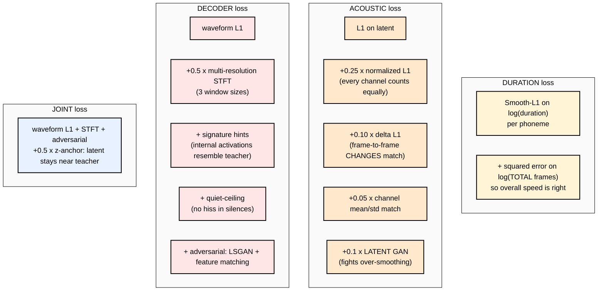
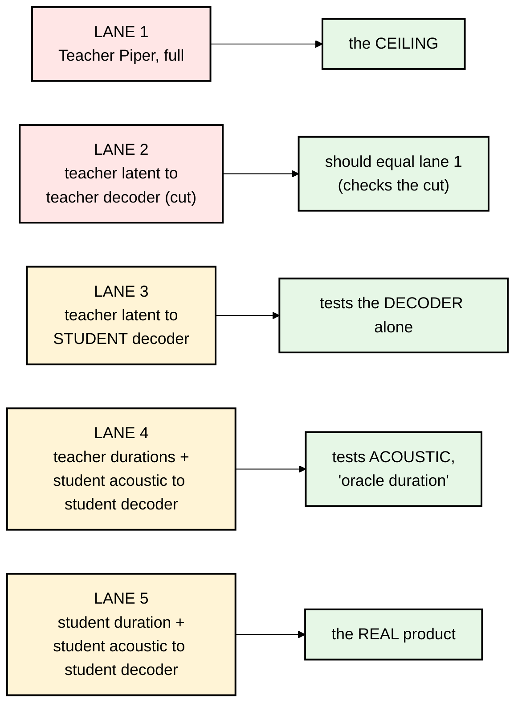

# 06 — Loss Functions, Tricks, and Honest Evaluation

File 01 said *"choosing the loss is choosing what the model learns."* This file shows every loss sanoTTS
uses, explains why each one exists, and then covers how the authors **measured** quality without fooling themselves.
Their docs call evaluation *"half the recipe."*

---

## Part A — The losses, student by student



### A1. Duration loss (`duration_loss` in `train_roota_piper_duration_student.py`)

```python
target_log = torch.log(target_duration.clamp_min(1.0))
token_loss = F.smooth_l1_loss(pred_log[mask], target_log[mask], beta=0.25)   # per-phoneme timing
total_loss = mean( (log(sum(pred_frames)) - log(sum(target_frames)))**2 )     # whole-sentence length
loss = token_loss + total_weight * total_loss
```

- **Smooth-L1** behaves like squared error for small mistakes and like absolute error for big ones, so one weird
  sample can't dominate training.
- **The total term** exists because many small per-phoneme errors can add up to a sentence that's 15% too fast.
  During training the log reports `batch_frame_ratio` (predicted ÷ teacher total frames); you want ~1.0.

### A2. Acoustic loss (`latent_loss_components`, `weighted_latent_loss`)

| Term | Formula (idea) | Why it's there |
|---|---|---|
| `l1` | `mean(|pred − target|)` | the basic "match the latent" |
| `norm_l1` (×0.25) | L1 after dividing each channel by its std | some of the 192 channels are tiny but important; without this they're ignored |
| `delta_l1` (×0.10) | L1 on `pred[t+1] − pred[t]` vs the same for target | makes the *motion* over time match; otherwise output is mushy |
| `channel_stat` (×0.05) | mean & std of each channel over the utterance match | stops the output collapsing to low-variance "average" values |

**The over-smoothing problem, and the latent GAN.** Any model trained only with L1/L2 learns to predict the *average*
of all plausible answers. Averages are smooth and dull: flat prosody, blurry sounds. The fix is a small
**discriminator** (`LatentDiscriminator`, a PatchGAN-style 1-D CNN) that looks at latents and tries to tell teacher from student:

```python
# discriminator step ("hinge" loss): real = teacher latent, fake = student latent
d_real = latent_disc(target.detach())
d_fake = latent_disc(prediction.detach())
latent_disc_loss = F.relu(1.0 - d_real).mean() + F.relu(1.0 + d_fake).mean()
# student step: be scored as "real"
latent_adv_g = -latent_disc(prediction).mean()
loss = loss + 0.1 * latent_adv_g
```

It switches on after step 1,500 (the student first learns roughly, then gets sharpened), and **the discriminator is never shipped.**
The docstring: *"It pushes the student's predicted latent toward the teacher latent's distribution (defeating L2 regression-to-the-mean,
i.e. the over-smoothing that flattens prosody and depresses SCOREQ)."*

### A3. Decoder loss (the `loss = (...)` block near line 8666 of `train_roota_piper_decoder_student.py`)

The decoder script has **28 possible loss terms** from months of experiments; most are off (weight 0) by default.
The ones the shipped recipe turns on:

**1. Waveform L1:** sample-by-sample difference. Simple, but it alone gives muffled audio, because two waveforms can sound
identical while being shifted in phase.

**2. Multi-resolution STFT loss (weight 0.5):**

```python
for n_fft, hop in ((512, 128), (1024, 256), (2048, 512)):
    loss += L1( log1p(|STFT(pred)|), log1p(|STFT(true)|) )
```

It compares **spectrograms** at three window sizes: short windows catch timing/clicks, long windows catch pitch/frequency detail.
Taking only the magnitude `|STFT|` ignores phase, which matches how we hear. `log1p` compresses loud vs quiet the way ears do.

**3. Signature hints (0.05) and signature temporal (0.4):** from stage 6's recordings of the teacher's internal activations.
The student's internal activations at matching points (after each stage, before the final tanh) are pooled to the frame rate,
summarized (mean, log-RMS), and compared to the teacher's. The "temporal" version compares **how activations change over time**
using a cosine similarity matrix (`temporal_cosine_gram`). It's guidance about *how* to compute, not just *what* to output.

**4. Quiet ceiling (0.010):** finds the quietest frames in the teacher audio (silences, pauses) and **penalizes the student only if it's
louder than the teacher there** (by more than 0.5 dB). Small decoders tend to hiss or buzz in silence, and this targets exactly that.

**5. Adversarial (0.075) + feature matching (0.75):** a **Multi-Period Discriminator** (from HiFi-GAN) looks at the audio
reshaped by periods such as 2, 3, 5, 7, 11 samples. That exposes whether the pitch periodicity looks real. Losses are LSGAN
(least squares): `(D(real) − 1)² + D(fake)²` for the discriminator, `(D(fake) − 1)²` for the student. **Feature matching** additionally
asks that the discriminator's *internal layers* respond to student audio the same way as to teacher audio. That's a very stable, rich signal.

### A4. The "de-metal" and sibilant fixes (inference-time and polish)

- **De-metal:** a short extra fine-tune with the multi-period discriminator + an STFT **phase** loss removed a "metallic tail".
- **Sibilant noise injection** (`tools/calibrate_sibilant_noise.py`): the acoustic student is deterministic, so for स/श/ज़ it predicts
  the *average* latent, and the average of noise is a whistle. Retraining doesn't fix this; the recipe calls it architectural. So at
  inference they **add a little random noise to the latent only at sibilant frames**, with per-channel strength measured from the teacher.
  The decoder already knows how to render noisy latents as hiss. This is a clever "fix it at inference, not with more training" move.
  **For Nepali, the same idea would probably help aspirated consonants (ख घ छ झ ठ ढ थ ध फ भ).** That's an idea to test, not something the repo does.

---

## Part B — Honest evaluation

### B1. The "lanes": finding *which* model is the problem

This is the most useful debugging idea in the repo. Render the **same eval sentences** through several pipelines:



And the diagnosis table from `docs/roota-language-porting-recipe.md`:

| Symptom | Likely culprit | What to do |
|---|---|---|
| Lane 1 (teacher) sounds bad | **teacher choice** | pick another teacher; a student can't beat it |
| Lane 3 bad | **decoder** | change decoder size/init/loss; don't touch the others yet |
| Lane 3 good, lane 5 bad | **acoustic / interface** | z-mix, joint finetune, calibration |
| Lane 4 fixes lane 5 | **duration** | tune the duration model or `length_scale` |
| Only new, arbitrary text fails | **frontend / normalization** | fix G2P, not the model |
| Metrics improve but it sounds worse | **bad metric** | trust your ears; add a better probe |

### B2. The metrics, and why no single one is trusted

| Metric | Measures | Tool | Caveat |
|---|---|---|---|
| **SCOREQ** | predicted naturalness (no reference needed) | `tools/eval_mos_all.py` | trained mostly on English; *"rated a metallic-tail model above TinyTTS"* |
| **UTMOS** | predicted MOS (naturalness) | same | same family of blind spots |
| **DNSMOS-SIG** | signal quality / distortion | same | *"the one that catches metallic distortion"* |
| **WER / CER via Whisper** | **intelligibility**: do the words arrive? | `tools/eval_scorecard.py` | depends on Whisper's own skill in that language; weak for Nepali |
| **Phoneme-class flatness** | per sound class (sibilants, vowels...) noise fidelity vs teacher | `tools/eval_phoneme_class_fidelity.py` | built after global metrics missed the whistly /s/ |
| **G2P parity** | does the on-device phonemizer give the same IDs as espeak? | `tools/eval_g2p_parity.py` | 0% error = bit-exact |
| **Golden correlation** | does the C/WASM/int8 build reproduce the PyTorch output? | `mcu/test/golden_main.c` | gate: correlation ≥ 0.98 |

"MOS" = Mean Opinion Score: humans rate audio 1–5. SCOREQ/UTMOS/DNSMOS are **neural networks that predict** what humans would say.

**The lessons the authors wrote down (worth memorizing):**
- *"Use an unseen gate. Templated/synthesis-adjacent text inflates every score by ~1.3 SCOREQ."*
- *"Report multiple predictors + listen."*
- *"Every real defect in this project was caught by a human ear or a resolution-increasing probe before a scalar metric agreed."*
- *"Closed-set dashboards are not enough. Serve arbitrary text before claiming a voice works."* (`tools/serve_roota_arbitrary_tts_dashboard.py`
  starts a local web page where you type any text and hear all the lanes.)

### B3. For Nepali specifically

The README table shows **no SCOREQ and no WER for Nepali** (*"Nepali, Hindi and Chinese predate that harness and have neither number"*),
and *"No listening test has been run on any non-English voice."* So nobody has measured how good the Nepali voice is.
Building a Nepali evaluation set (text + native-speaker listening + an ASR that's actually good at Nepali) would be step one of improving it.
More in files 08 and 09.

Next: **[07-deployment-quantization-web-and-chip.md](07-deployment-quantization-web-and-chip.md)**

### Official links for this chapter
- Smooth L1 loss: https://pytorch.org/docs/stable/generated/torch.nn.SmoothL1Loss.html
- GANs, original paper: https://arxiv.org/abs/1406.2661
- LSGAN (least-squares GAN): https://arxiv.org/abs/1611.04076
- HiFi-GAN (multi-period discriminator, feature matching): https://arxiv.org/abs/2010.05646
- Parallel WaveGAN (multi-resolution STFT loss): https://arxiv.org/abs/1910.11480
- PatchGAN idea (pix2pix paper): https://arxiv.org/abs/1611.07004
- SCOREQ: https://github.com/alessandroragano/scoreq
- UTMOS: https://github.com/sarulab-speech/UTMOS22
- DNSMOS (Microsoft DNS Challenge): https://github.com/microsoft/DNS-Challenge/tree/master/DNSMOS
- Whisper (used for WER): https://github.com/openai/whisper
- Word error rate explained (jiwer library): https://github.com/jitsi/jiwer
