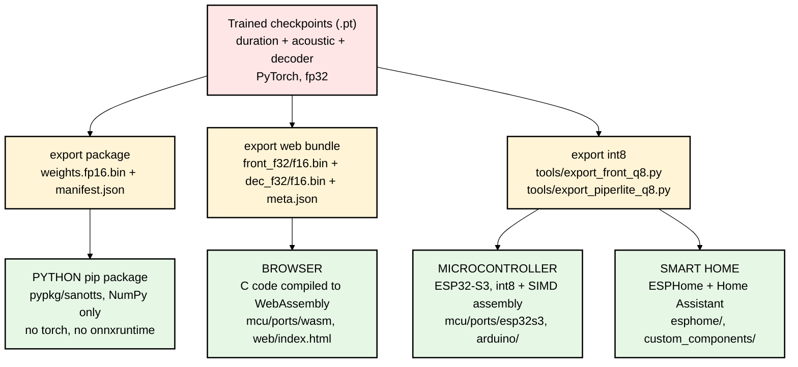
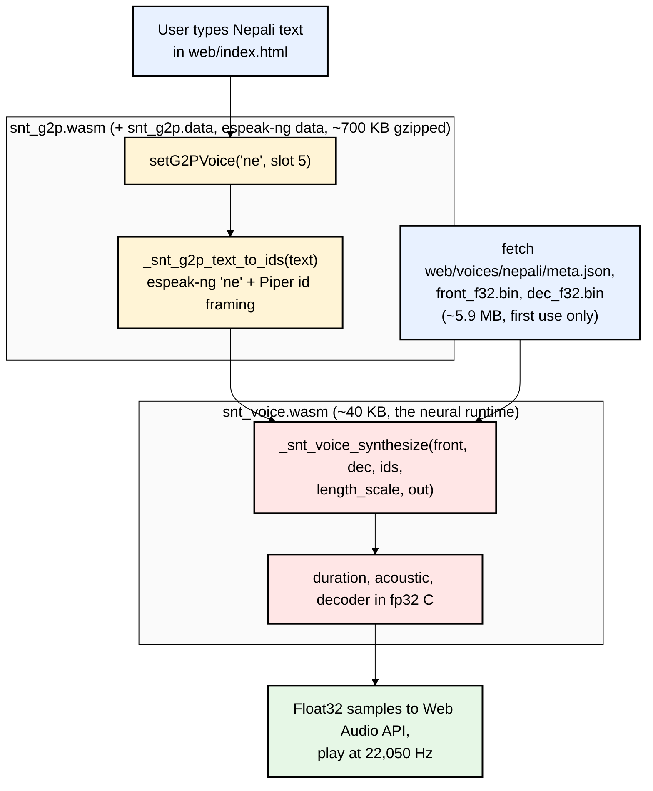
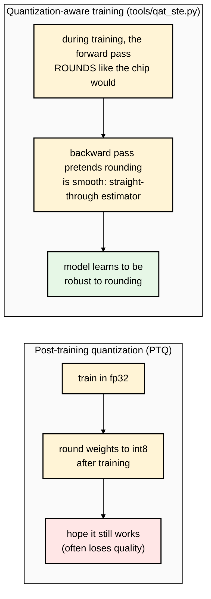

# 07 — Shipping It: Export, int8 Quantization, the Browser, and a $3 Chip

Training produces PyTorch `.pt` files, which need Python + PyTorch (hundreds of MB) to run.
The last part of sanoTTS is making the **same math** run in tiny, dependency-free forms.
For your products (GurukulHQ, RakamHQ, Vidhica) this part matters most in practice: it decides
whether TTS can run **on the user's device, offline, for free**, instead of paying per request to a cloud API.

---

## The four ways a sanoTTS voice runs



**The Nepali voice today ships only as the browser fp32 bundle** (`web/voices/nepali/`: `front_f32.bin` 3.3 MB + `dec_f32.bin` 2.6 MB).
The README: *"Nepali, Hindi and Chinese are browser-only for now."*

---

## Part A — The C runtime (`mcu/`): one core, many platforms

The authors rewrote the three models' forward pass in **plain C99** (`mcu/src/`):

| File | What it runs |
|---|---|
| `snt_front_f32.c` | duration + acoustic ("front half"), float32 |
| `snt_piperlite.c` | the decoder, float32 |
| `snt_front_q8.c`, `snt_piperlite_q8.c` | the same two, int8 |
| `snt_tts.c` | an older, smaller int8 stack (the "R7" lineage, the chip's "robot" voice) |
| `snt_kernels_ref.c` | the plain math kernels (dot products, matrix-vector) |

Design rules worth copying in your own embedded work (from `mcu/README.md`):
- **The library never calls `malloc`.** The caller hands it one memory "arena" buffer, so memory use is fixed and known in advance.
- **A port only needs to implement 3 math kernels + 4 small shims** (`mcu/include/snt_port.h`). A new chip = rewrite those, nothing else.
- **Golden-vector gate:** every build must reproduce the PyTorch output with **correlation ≥ 0.98** (`mcu/test/golden_main.c`).
  This is how they *prove* the C / WASM / int8 versions are the same model, not "roughly similar".

---

## Part B — The browser (WebAssembly)

**WebAssembly (WASM)** lets C code run inside a web page at near-native speed. The authors compile with **Emscripten**.
For every non-English espeak voice (including Nepali) the browser loads two WASM modules:



**Everything happens in the visitor's browser. No server, no upload.** For a product in Nepal, where mobile data costs money
and connectivity drops, that's a genuinely important property. The trade-off is a one-time ~6 MB download for the Nepali voice
(an fp16 version would be ~3 MB; the README notes older voices weren't converted only because their published numbers were measured on fp32).

The npm package `sanotts-web` wraps this (`npmpkg/`). Nepali is listed there as voice key `nepali`.

---

## Part C — int8 quantization: making it fit on a chip

### C1. The idea

Store each weight as a **1-byte integer (−127…127)** plus one float **scale** per output channel, instead of a 4-byte float:

```
real_weight ≈ int8_weight × scale,    where scale = max(|row|) / 127
```

That's **4× smaller** and much faster on chips with integer SIMD units (the ESP32-S3 can do 16 int8 multiply-adds in one instruction).
Activations (the intermediate values while running) are also quantized to int8 on the fly.

### C2. The subtle part: simulation has to match the chip exactly

The authors learned that a "roughly int8" simulation in PyTorch **lies**. From `tools/mcu_quant_sim.py`:

> If the simulation is optimistic we ship a model that fails the on-device gate; if it is pessimistic we throw away architectures that would have worked.

The C code computes **one activation scale per output column over the whole receptive window** (`in_ch × K` values), and rounds
"half away from zero". A naive PyTorch fake-quant scales per frame and rounds half-to-even, which is finer and therefore **optimistic**.
So they wrote a **C-faithful simulator** and checked it against the real chip's output.

### C3. Post-training quantization vs. quantization-aware training (QAT)



Real example from the repo: the `heart` voice's int8 form *"fails the 0.98 golden gate at 0.951 minimum correlation"*, so it ships in float32.
`heart-nano` (294k params) was trained with QAT and ships as **337 KB of int8**.

### C4. What runs on the ESP32-S3 (~$3 chip)

From `BOARDS.md` and `mcu/README.md`:
- The on-device English voice ("robot", 567k params, int8, ~640 KB of weights) runs at **RTF 0.383**:
  1 second of audio takes 0.383 s to compute, i.e. 2.6× faster than real time, using hand-written Xtensa SIMD assembly
  (`arduino/src/snt_matvec_esp32s3.S`).
- Plain C on the same board: RTF 1.58, slower than real time. **The SIMD kernels are what make it real-time.**
- RAM working set about 300 KB; around 45 million int8 multiply-adds per second of audio.
- espeak-ng itself was ported onto the chip (`esphome/g2p/idf/espeak_ng/`) so the board can phonemize text by itself.
  A Nepali on-chip voice would need the `ne` dictionary data on the chip too.

**RTF (real-time factor)** = compute time ÷ audio duration. Below 1.0 means faster than real time.

---

## Part D — Why this matters for a Nepal-first product

| Deployment | What it enables for you |
|---|---|
| Browser WASM | TTS inside GurukulHQ / Vidhica web apps with **zero server cost**, working offline after the first load |
| NumPy package | cheap server-side batch generation (e.g. audio for lessons) without GPUs |
| Android/Kotlin (`mobile/kotlin`) | on-device TTS in a mobile app |
| ESP32 | talking hardware (kiosks, education devices, accessibility aids) for a few dollars |

The **runtime** code (`mcu/src/snt_*.c`, `mcu/include/`, `mobile/`) is **MIT-licensed**. The **espeak-ng G2P** is **GPL-3.0**,
and anything that embeds it inherits GPL obligations (README "License" section). For a commercial product that's a real constraint:
one reason a **Nepali G2P you own** is valuable (file 09).

Next: **[08-nepali-case-study.md](08-nepali-case-study.md)**

### Official links for this chapter
- WebAssembly: https://webassembly.org/
- Emscripten docs: https://emscripten.org/docs/getting_started/index.html
- Web Audio API (MDN): https://developer.mozilla.org/en-US/docs/Web/API/Web_Audio_API
- PyTorch quantization overview: https://pytorch.org/docs/stable/quantization.html
- Quantization whitepaper (Krishnamoorthi, Google 2018), a clear intro to per-channel int8 and QAT: https://arxiv.org/abs/1806.08342
- Straight-through estimator (Bengio et al. 2013): https://arxiv.org/abs/1308.3432
- ESP32-S3 / ESP-IDF docs: https://docs.espressif.com/projects/esp-idf/en/latest/esp32s3/
- ESP-DSP / ESP-NN (Espressif's SIMD libraries): https://github.com/espressif/esp-nn
- ESPHome: https://esphome.io/
- GPL-3.0 FAQ (what "copyleft" means for your product): https://www.gnu.org/licenses/gpl-faq.html
