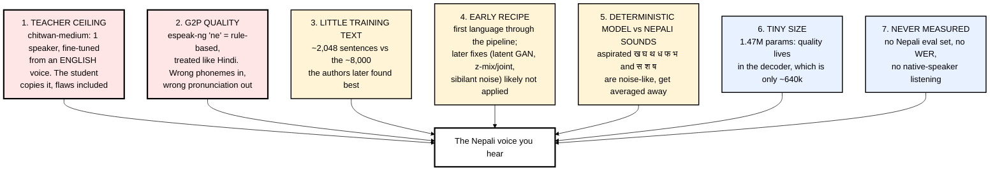
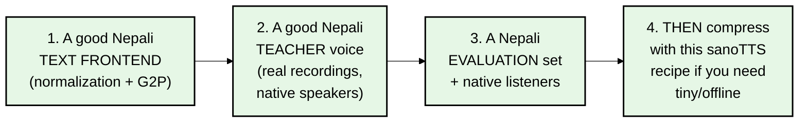

# 08 — Nepali Case Study: How the Nepali Voice Was Made, and Why It Sounds Weak

You said the Nepali TTS in this project "is also not great". This file explains exactly why, using evidence from the
repo and the official Piper model cards. It's the most practical file for your goal, because **every weakness here
is a lesson about what a Nepal-first system must do differently.**

> Legend: ✅ = verified in the repo or an official source. 🔎 = my inference from file names / paths (likely, but not stated outright).

---

## 1. What the Nepali voice is

| Fact | Value | Source |
|---|---|---|
| Teacher | Piper **`ne_NP-chitwan-medium`** | ✅ default paths in `tools/build_piper_vits_roota_probe_pack.py`, `mcu/ports/wasm/verify_g2p_node.mjs` |
| Teacher training | single speaker, CC0 data (OHF-Voice voice-datasets), **fine-tuned from the US-English "lessac" voice** | ✅ official Piper MODEL_CARD |
| G2P | espeak-ng voice **`ne`**, sharing rules with Hindi/Marathi/etc. | ✅ `web/voices/nepali/meta.json`, `tr_languages.c` |
| Duration student | hidden 64, depth 3, kernel 5 (~137k params) | ✅ meta.json (`d_*`) |
| Acoustic student | token_context, hidden 96, token depth 3, frame depth 4 (~698k) | ✅ meta.json (`a_*`) |
| Decoder student | piperlite 148/74/37/18 (~640k) | ✅ meta.json (`dec_dims`) |
| **Total** | **1,474,771 params ≈ 1.47M** | ✅ 835,243 + 639,528 |
| Shipped format | **fp32 only**, browser only, 5.9 MB | ✅ `web/voices/nepali/*.bin`, README |
| Checkpoint set name | `nepali-chitwan-a5-a16-a91` | ✅ meta.json `checkpoints` |
| Measured quality | **none**: no SCOREQ, no WER, no listening test | ✅ README voice table + notes |

### Decoding the run names 🔎

The authors name runs by experiment number. The Nepali run names that appear as defaults in the tools:

| Stage | Run name | What it tells us |
|---|---|---|
| Pack | `chitwan-medium-a1-mod10-train2048-max12-acoustic-pack-20260625` | about **2,048 training sentences**, built 2026-06-25 |
| Duration | `chitwan-medium-a5-duration-student-h64d3-4000-20260625` | hidden 64, depth 3, 4,000 steps |
| Acoustic | `chitwan-medium-a16-acoustic-objective-v2-norm025-delta010-stat005-lr5e5-2000-20260625` | norm-L1 0.25, delta 0.10, channel-stat 0.05, lr 5e-5, **2,000 steps**, **no latent-GAN term in the name** |
| Decoder | `a91` (the porting recipe's "a91 decoder piperlite 640k" example) | teacher-init piperlite ~640k |
| Source text | `artifacts/nepali-mfa-male25-policy-clean/acoustic-duration-sat3-single-top-speaker.jsonl` | text from a Nepali speech corpus processed with **MFA** (Montreal Forced Aligner). The dataset itself isn't in the repo |

**Nepali was the very first language through this pipeline** (June 2026). The porting recipe even warns that the decoder-signature
default node names are *"historical Chitwan-era node names"*. Many of the improvements (latent GAN, the z-mix → joint stages
the orchestrator runs, 8k-row packs, sibilant injection) came **later**, mostly while working on English.
The preserved checkpoint set is named `a5-a16-a91` (duration, acoustic, decoder), with no z-mix or joint checkpoint in the name. 🔎

---

## 2. Why it sounds weak: the seven reasons, ranked

### Reason 1 — The teacher ceiling (the biggest one)

Distillation copies **one** teacher. The recipe says it plainly: *"If the teacher is unpleasant, do not distill it.
A tiny student will mostly preserve the wrong target."*

`chitwan-medium` is a medium-quality Piper voice, **fine-tuned from an English voice**. Fine-tuning from another language
is a normal and useful shortcut (Piper's own docs say it *"will speed up training a lot, even if the checkpoint is from a different language"*),
but a single speaker with a limited dataset gives a modest ceiling. The student then loses some quality on top of that.
The authors' own diagnosis table puts it first: *"Teacher itself sounds bad → Teacher choice → Pick another Piper voice."*

There is **only one other Nepali Piper option** (`ne_NP-google-medium`, 18 speakers from OpenSLR 43, also fine-tuned from English).
So for Nepali you can't simply "pick a better teacher". That's why building a better Nepali teacher is on the roadmap (file 09).

### Reason 2 — G2P: espeak-ng Nepali

The student doesn't read Devanagari. It only sees the IDs espeak produces. In `tr_languages.c`, Nepali sits in the **same
`case` block as Hindi, Oriya, Punjabi, Gujarati and Marathi**: same stress timing tables, same stress rule, same number handling.
Nepali has its own dictionary rules file (`ne_dict`), but espeak's Nepali support is community-maintained and limited. Typical
trouble spots for any rule-based Nepali G2P:

- **Schwa (inherent-vowel) deletion**: when is the final or middle 'अ' spoken? Nepali differs from Hindi here.
- **Numbers, dates, currency** (रु. ५००, २०८१ साल), and **Nepali vs. Western digits** (५ vs 5).
- **English loanwords** written in Devanagari or mixed with Roman script (very common in real app text).
- Nasalization (ँ vs ं), conjuncts, ज्ञ (pronounced "gya" in Nepali).

Both the teacher and the student were trained on espeak's phonemes, so errors are **baked in** in a consistent way. The authors saw
the same thing for Indonesian: when they built a *correct* G2P, word error rate got *worse* at first, because *"the current weights were
distilled on espeak's phonemes, so correct ones are a distribution they never saw."* **Lesson: fix the G2P first, then train.**

### Reason 3 — Not enough (and maybe not varied enough) text

The acoustic model is *"data-limited"*. The recipe says 8k rows is the sweet spot, and 3k rows *"caps the model"*.
The Nepali pack had about 2k. Also, the authors warn that templated text inflates scores by ~1.3 SCOREQ. Look at their Hindi
training text (`data/textsets/multilang-distill-v1/hi_IN.train.jsonl`) and you'll see it's heavily templated:
*"छोटा आवाज़ मॉडल को … साफ़ बोलना चाहिए।"* repeated with variations. There's no Nepali textset in `data/textsets/`, so we can't check the Nepali one.

### Reason 4 — An early version of the recipe

Nepali ran on 2026-06-25. The acoustic run name lists only L1 / norm / delta / stat terms; the **latent discriminator** (worth
*"roughly +1.3 SCOREQ"* on English) appears in later runs. The decoder-signature defaults were Nepali-era names that later broke.
By contrast, the Indonesian and Vietnamese voices went through the cleaned-up orchestrator with z-mix + joint finetune ✅, and the ten languages added 2026-09-08 ship as fp16 with out-of-domain WER measurements ✅.

### Reason 5 — Nepali phonetics vs. a deterministic model

File 02 explained that a deterministic model predicts the **average**, and the average of noise is a dull tone.
English has a handful of sibilants. **Nepali has a full series of aspirated stops and affricates** (ख घ छ झ ठ ढ थ ध फ भ) plus स श ष,
all with noisy bursts, so this weakness shows up more often. The sibilant-noise trick (file 06) wasn't applied to Nepali.

### Reason 6 — It's just very small

1.47M parameters is tiny. The frontier chart shows quality climbing steadily with decoder size. Kokoro (82M) is 55× bigger.
This was a deliberate choice (it runs on a chip), not an accident.

### Reason 7 — Never measured, so never tuned

No Nepali eval set, no Whisper WER (Whisper is weak at Nepali anyway, so it'd be a noisy gauge), and no native listener.
You can't improve what you don't measure. The authors' whole philosophy is "listen + probe", but for Nepali that loop never ran.

---

## 3. What you can learn from this for your own work

sanoTTS solves step 4, *making a voice tiny*, very well. **Steps 1–3 are the Nepal-specific work nobody has done well yet**, and that's where
a Nepal-origin team has a real advantage: native speakers, local text, local domain knowledge (education, finance, government language).

---

## 4. Quick experiments you could run *today* with what's in the repo

1. **Listen to the teacher vs. the student.** Install `piper-tts`, download `ne_NP-chitwan-medium` and `ne_NP-google-medium`, render the same
   10 sentences with each, then compare with the sanoTTS demo (https://ampixa.github.io/sanoTTS/). You'll hear how much of the weakness
   comes from the teacher. (Commands in file 09.)
2. **Inspect espeak's Nepali phonemes.** `brew install espeak-ng`, then
   `espeak-ng -v ne -q --ipa "नमस्ते! आज मौसम धेरै राम्रो छ।"` and judge the IPA as a native speaker. Every wrong phoneme you find is a G2P bug.
3. **Try `length_scale`.** `web/voices/nepali/meta.json` has `"length_scale": 1.0`. The id/vi voices shipped at 1.16 (slower), tuned by ear
   with no retraining. Nepali may simply sound better slightly slower.
4. **Open the teacher graph in Netron** (https://netron.app/) and find the `Ceil` node and `dec.conv_pre`, the two cut points from file 03.

Next: **[09-roadmap-your-own-nepali-tts-and-stt.md](09-roadmap-your-own-nepali-tts-and-stt.md)**

### Official links for this chapter
- Nepali Piper voices: https://huggingface.co/rhasspy/piper-voices/tree/main/ne/ne_NP
- chitwan model card: https://huggingface.co/rhasspy/piper-voices/blob/main/ne/ne_NP/chitwan/medium/MODEL_CARD
- google (Nepali) model card: https://huggingface.co/rhasspy/piper-voices/blob/main/ne/ne_NP/google/medium/MODEL_CARD
- OHF-Voice voice datasets (chitwan's data source): https://github.com/OHF-Voice/voice-datasets
- OpenSLR SLR43 (Google Nepali TTS data): https://www.openslr.org/43/
- espeak-ng: https://github.com/espeak-ng/espeak-ng
- Montreal Forced Aligner: https://montreal-forced-aligner.readthedocs.io/
- sanoTTS live demo: https://ampixa.github.io/sanoTTS/
