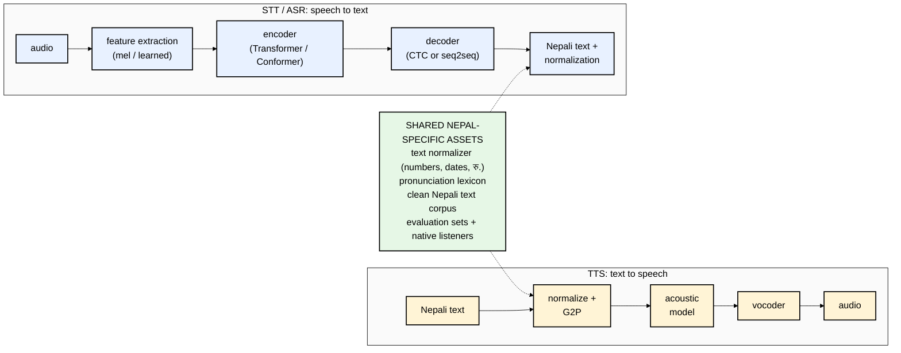
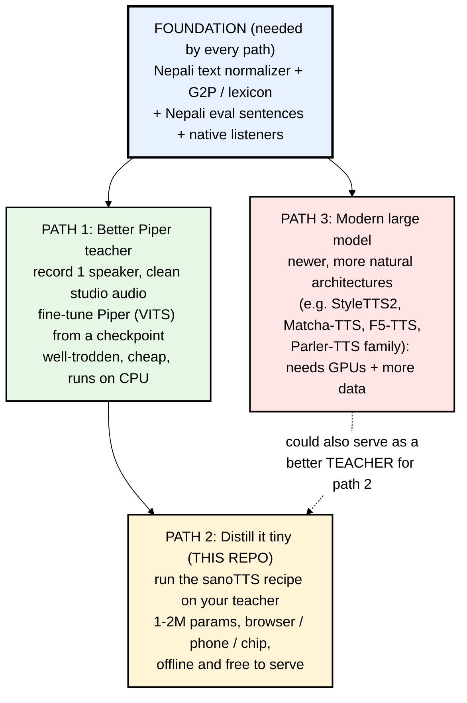
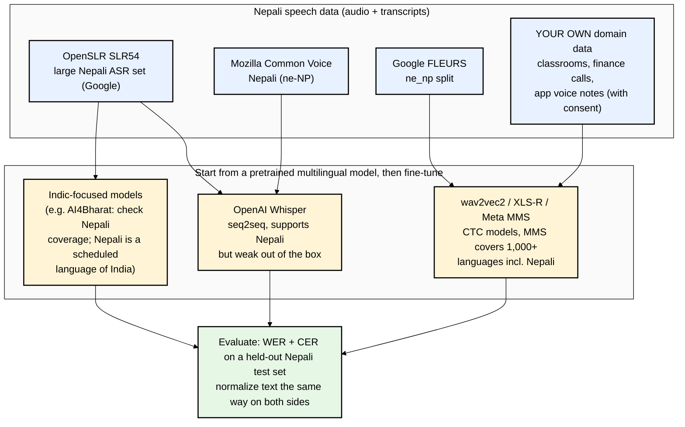

# 09 — A Map for Building Your Own Nepali TTS *and* STT

> **Status:** orientation only. You said the goal for now is to understand this codebase, and that we'll discuss next steps
> together. This file is the "lay of the land" so those conversations have a shared map. Nothing here is a final plan,
> and anything marked *"check"* should be verified before you commit time to it.

---

## 1. TTS and STT are mirror images



Key difference: **TTS wants a few voices recorded very cleanly** (studio quality, consistent speaker).
**STT wants many voices recorded messily** (phones, noise, accents from Kathmandu, Terai, hills, children, elders),
because it has to understand everyone.

---

## 2. TTS: three paths, from cheapest to most ambitious



### Foundation: the Nepali frontend (do this first, whatever path)

File 08 showed G2P errors get **baked into** every model downstream. A Nepal-first frontend would handle:
- **Normalization**: Devanagari and Western digits (२०८१ / 2081), dates (Bikram Sambat!), currency (रु.), phone numbers, abbreviations, English words in mixed text.
- **G2P**: schwa deletion rules, conjuncts, nasalization, plus a **lexicon of exceptions** (names, places, loanwords) checked by native speakers.
- **Ownership**: written by you, so it isn't GPL-bound like espeak-ng (file 07). sanoTTS did exactly this for English/Indonesian/Vietnamese
  (`pypkg/sanotts/piper_g2p.py`, `id_indo_g2p.py`, `vi_g2p.py`). Those files are good templates to study.

### Path 1: a better Piper teacher

Piper's training docs support fine-tuning from an existing checkpoint (even of another language) on your own data:
a CSV of `audio_file|text`, espeak or custom phonemes, then export to ONNX. With **your own Nepali G2P via "custom phoneme ids"**
you'd fix pronunciation at the source. Data rule of thumb for single-speaker TTS: *more clean hours of one consistent voice beats
more messy hours of many voices* (*check* current Piper guidance for recommended hours).

### Path 2: compress it with sanoTTS (what you've been learning)

Once you have a good teacher (from path 1 or 3), the recipe in files 03–06 turns it into a 1–2M-parameter voice that runs in
GurukulHQ/Vidhica in the browser for free. You'd need to fill the missing scripts (file 04), especially the teacher-parity stage.

### Path 3: modern large models

More natural, more expressive, often multi-speaker or zero-shot, but they need GPUs to train and usually to run. Good for server-side
quality or as a better teacher. *Check* current options and whether they support Nepali or can be fine-tuned on it.

---

## 3. STT (speech-to-text) for Nepali: the landscape

This repo has **no STT code**; it only uses Whisper to *measure* TTS. But since you asked about STT too, here's the map:



- **Fine-tuning** a pretrained model (not training from scratch) is the standard approach. The same "stand on a big model's
  shoulders" idea as distillation, used differently.
- **CER** (character error rate) is often more meaningful than WER for Nepali, because word boundaries and spelling variants
  (e.g. different ways to write the same word) inflate WER.
- A good STT also gives you something useful for TTS: you can **transcribe** audio to build TTS datasets, and **measure** TTS intelligibility properly.

---

## 4. The Nepal-specific moat

What you have that Google/Sarvam-scale players have less of:

| Asset | Why it matters |
|---|---|
| Native speakers on the team | the only real judge of pronunciation and naturalness (file 06: "the ear breaks ties") |
| Domain text (education, finance, legal) | your products' vocabulary, which general models get wrong |
| Local users | consented, real-world audio for STT; feedback loops |
| Offline-first need | Nepal's connectivity makes sanoTTS-style on-device models a real product edge, not a gimmick |

---

## 5. Hands-on starter commands (for when you're ready)

Listen to the two Nepali Piper teachers (piper1-gpl CLI, verified against its docs):

```bash
python3 -m venv .venv && source .venv/bin/activate
pip install piper-tts

python3 -m piper.download_voices ne_NP-chitwan-medium
python3 -m piper.download_voices ne_NP-google-medium

python3 -m piper -m ne_NP-chitwan-medium -f chitwan.wav -- 'नमस्ते! आज मौसम धेरै राम्रो छ।'
python3 -m piper -m ne_NP-google-medium  -f google.wav  -- 'नमस्ते! आज मौसम धेरै राम्रो छ।'
```

See what espeak-ng thinks Nepali sounds like:

```bash
brew install espeak-ng
espeak-ng -v ne -q --ipa 'नमस्ते! आज मौसम धेरै राम्रो छ।'
```

Read the recipe's own dry run to see every command the pipeline would execute:

```bash
python3 tools/train_voice_from_piper.py --voice ne_NP-chitwan-medium --auto-text --dry-run
# (--auto-text doesn't support Nepali; with a real run you'd pass --text your_nepali.jsonl)
```

---

## 6. Suggested questions for our next conversations

1. "Walk me through `train_roota_piper_duration_student.py` line by line and let's run it on a tiny pack."
2. "Let's write the missing teacher-parity script (stage 5) together."
3. "How would I design a Nepali G2P + normalizer? Let's start with numbers and schwa deletion."
4. "What would a Nepali TTS evaluation set look like, and how do we run a listening test?"
5. "For STT: Whisper fine-tune vs MMS, which first for our use case?"

Next: **[10-glossary-and-official-links.md](10-glossary-and-official-links.md)**

### Official links for this chapter
- Piper training guide: https://github.com/OHF-Voice/piper1-gpl/blob/main/docs/TRAINING.md
- Piper CLI docs: https://github.com/OHF-Voice/piper1-gpl/blob/main/docs/CLI.md
- OpenSLR SLR54 (Nepali ASR data): https://www.openslr.org/54/
- OpenSLR SLR43 (Nepali TTS data): https://www.openslr.org/43/
- Mozilla Common Voice: https://commonvoice.mozilla.org/
- Google FLEURS dataset: https://huggingface.co/datasets/google/fleurs
- Whisper: https://github.com/openai/whisper
- Fine-tune Whisper with Hugging Face (official blog tutorial): https://huggingface.co/blog/fine-tune-whisper
- Meta MMS (Massively Multilingual Speech): https://huggingface.co/docs/transformers/model_doc/mms
- wav2vec2 fine-tuning guide: https://huggingface.co/blog/fine-tune-xlsr-wav2vec2
- AI4Bharat (Indic speech models; check Nepali coverage): https://ai4bharat.iitm.ac.in/
- Hugging Face Audio Course (ASR and TTS units): https://huggingface.co/learn/audio-course
